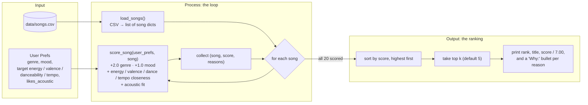

# 🎵 Music Recommender Simulation

## Project Summary

In this project you will build and explain a small music recommender system.

Your goal is to:

- Represent songs and a user "taste profile" as data
- Design a scoring rule that turns that data into recommendations
- Evaluate what your system gets right and wrong
- Reflect on how this mirrors real world AI recommenders

Replace this paragraph with your own summary of what your version does.

---

## How The System Works

**Song features used:** genre, mood, energy, valence, danceability, tempo_bpm, acousticness.

**UserProfile stores:** favorite genre, favorite mood, target energy / valence / danceability / tempo, and whether they like acoustic sound.

### Algorithm Recipe

Each song is scored independently against the user profile (max **7.0** points):

| Rule | Points | Why this weight |
|---|---|---|
| Genre matches `favorite_genre` | **+2.0** | Strongest identity signal. 17 genres across 20 songs, so a match is rare and meaningful. |
| Mood matches `favorite_mood` | **+1.0** | Captures the "vibe," but moods overlap (chill / relaxed / laid-back), so a miss is less damning than a genre miss. |
| Energy closeness | **+1.5 × (1 − \|song − target\|)** | Most spread-out numeric feature (0.22–0.98); separates calm from intense best. |
| Valence closeness | **+0.5 × (1 − \|song − target\|)** | Fine-tuning: happy vs. dark. |
| Danceability closeness | **+0.5 × (1 − \|song − target\|)** | Fine-tuning: groove. |
| Tempo closeness | **+0.5 × (1 − min(\|song − target\| / 100, 1))** | BPM normalized by ~100 (catalog spans 60–168). |
| Acoustic fit | **+1.0 × acousticness** if `likes_acoustic`, else **+1.0 × (1 − acousticness)** | Rewards the texture the user prefers. |

Categorical matches are worth 3.0 of 7.0 points (~43%), and numeric similarity is worth 4.0. A song that matches both genre and mood almost always ranks first. The similarity scores then sort songs that only partly match.

**Choosing songs:** score every song, sort by score from highest to lowest, return the top `k` (default 5), and attach the reasons that added points as the explanation.

### Expected Biases

- **Over-prioritizes genre.** A +2.0 genre match can outweigh a song that fits the user's mood and energy better. For a pop/happy user, *Gym Hero* (pop/intense) outranks *Rooftop Lights* (indie pop/happy). Raising the mood weight to 1.5 does not change that order.
- **Exact string matching is brittle.** "indie pop" gets no credit for "pop", and "relaxed" or "laid-back" gets no credit for "chill". Labels that are close in meaning count as complete misses.
- **Catalog imbalance helps some users more than others.** Lofi has 3 songs, while most genres have only 1. A lofi fan gets a top 3 that all match their genre. A metal or blues fan gets one genre match, and the rest of their list is chosen by numeric similarity alone.
- **Filter bubble.** Because the top results tend to share the user's genre and mood, the system rarely surfaces something different the user might enjoy. It has no diversity or discovery bonus.
- **Fixed, hand-picked weights.** The weights reflect my judgment, not real listening data, and every user gets the same weights. Someone who cares more about mood than genre cannot express that.
- **Acoustic preference is all-or-nothing.** `likes_acoustic` is a true/false setting, so users in the middle are pushed toward one extreme.

### Data Flow



1. **Input:** `main.py` builds the `user_prefs` dict, and `load_songs()` reads `songs.csv` into a list of dicts. Numeric fields are converted to `float`.
2. **Process:** `recommend_songs()` runs `score_song()` on every song. Each call returns a `(score, reasons)` pair, where `reasons` lists what earned points, for example `"genre match: pop (+2.0)"`. The songs are scored independently, so each score depends only on that song and the user.
3. **Output:** the scored songs are sorted from highest to lowest score, the first `k` are kept, and each is returned as `(song, score, explanation)` for `main.py` to print.

---

## Getting Started

### Setup

1. Create a virtual environment (optional but recommended):

   ```bash
   python -m venv .venv
   source .venv/bin/activate      # Mac or Linux
   .venv\Scripts\activate         # Windows
   ```

2. Install dependencies

```bash
pip install -r requirements.txt
```

3. Run the app:

```bash
python -m src.main
```

### Running Tests

Run the tests with:

```bash
pytest
```

You can add more tests in `tests/test_recommender.py`.

---

## Sample Recommendation Output

The start of `python -m src.main` output, showing the default pop/happy profile and the late-night study (lofi/chill) profile. The full nine-profile run is in [Stress Test](#stress-test-diverse-and-adversarial-profiles).

```
$ python -m src.main
Loading songs from data/songs.csv...
Loaded songs: 20

========================================================================
Profile: Default pop/happy
  genre=pop  mood=happy  likes_acoustic=False
  energy=0.8  valence=0.8  danceability=0.8  tempo=120 BPM
========================================================================
#1  Sunrise City - Neon Echo  [pop / happy]
    Score: 6.76 / 7.00
    Why:
      + genre match: pop (+2.0)
      + mood match: happy (+1.0)
      + energy 0.82 vs target 0.8 (+1.47)
      + valence 0.84 vs target 0.8 (+0.48)
      + danceability 0.79 vs target 0.8 (+0.49)
      + tempo_bpm 118 vs target 120 (+0.49)
      + non-acoustic fit, acousticness 0.18 (+0.82)
    --------------------------------------------------------------------
#2  Gym Hero - Max Pulse  [pop / intense]
    Score: 5.64 / 7.00
    Why:
      + genre match: pop (+2.0)
      + energy 0.93 vs target 0.8 (+1.30)
      + valence 0.77 vs target 0.8 (+0.48)
      + danceability 0.88 vs target 0.8 (+0.46)
      + tempo_bpm 132 vs target 120 (+0.44)
      + non-acoustic fit, acousticness 0.05 (+0.95)
    --------------------------------------------------------------------
#3  Rooftop Lights - Indigo Parade  [indie pop / happy]
    Score: 4.56 / 7.00
    Why:
      + mood match: happy (+1.0)
      + energy 0.76 vs target 0.8 (+1.44)
      + valence 0.81 vs target 0.8 (+0.49)
      + danceability 0.82 vs target 0.8 (+0.49)
      + tempo_bpm 124 vs target 120 (+0.48)
      + non-acoustic fit, acousticness 0.35 (+0.65)
    --------------------------------------------------------------------
#4  Concrete Crown - Blocktide  [hip-hop / confident]
    Score: 3.60 / 7.00
    Why:
      + energy 0.78 vs target 0.8 (+1.47)
      + valence 0.62 vs target 0.8 (+0.41)
      + danceability 0.86 vs target 0.8 (+0.47)
      + tempo_bpm 94 vs target 120 (+0.37)
      + non-acoustic fit, acousticness 0.12 (+0.88)
    --------------------------------------------------------------------
#5  Laser Bloom - Pulsewave  [edm / euphoric]
    Score: 3.58 / 7.00
    Why:
      + energy 0.96 vs target 0.8 (+1.26)
      + valence 0.88 vs target 0.8 (+0.46)
      + danceability 0.93 vs target 0.8 (+0.43)
      + tempo_bpm 128 vs target 120 (+0.46)
      + non-acoustic fit, acousticness 0.03 (+0.97)

========================================================================
Profile: Late-night study (lofi/chill)
  genre=lofi  mood=chill  likes_acoustic=True
  energy=0.4  valence=0.6  danceability=0.55  tempo=80 BPM
========================================================================
#1  Library Rain - Paper Lanterns  [lofi / chill]
    Score: 6.73 / 7.00
    Why:
      + genre match: lofi (+2.0)
      + mood match: chill (+1.0)
      + energy 0.35 vs target 0.4 (+1.42)
      + valence 0.6 vs target 0.6 (+0.50)
      + danceability 0.58 vs target 0.55 (+0.49)
      + tempo_bpm 72 vs target 80 (+0.46)
      + acoustic fit, acousticness 0.86 (+0.86)
    --------------------------------------------------------------------
#2  Midnight Coding - LoRoom  [lofi / chill]
    Score: 6.62 / 7.00
    Why:
      + genre match: lofi (+2.0)
      + mood match: chill (+1.0)
      + energy 0.42 vs target 0.4 (+1.47)
      + valence 0.56 vs target 0.6 (+0.48)
      + danceability 0.62 vs target 0.55 (+0.47)
      + tempo_bpm 78 vs target 80 (+0.49)
      + acoustic fit, acousticness 0.71 (+0.71)
    --------------------------------------------------------------------
#3  Focus Flow - LoRoom  [lofi / focused]
    Score: 5.75 / 7.00
    Why:
      + genre match: lofi (+2.0)
      + energy 0.4 vs target 0.4 (+1.50)
      + valence 0.59 vs target 0.6 (+0.49)
      + danceability 0.6 vs target 0.55 (+0.48)
      + tempo_bpm 80 vs target 80 (+0.50)
      + acoustic fit, acousticness 0.78 (+0.78)
    --------------------------------------------------------------------
#4  Spacewalk Thoughts - Orbit Bloom  [ambient / chill]
    Score: 4.55 / 7.00
    Why:
      + mood match: chill (+1.0)
      + energy 0.28 vs target 0.4 (+1.32)
      + valence 0.65 vs target 0.6 (+0.47)
      + danceability 0.41 vs target 0.55 (+0.43)
      + tempo_bpm 60 vs target 80 (+0.40)
      + acoustic fit, acousticness 0.92 (+0.92)
    --------------------------------------------------------------------
#5  Coffee Shop Stories - Slow Stereo  [jazz / relaxed]
    Score: 3.74 / 7.00
    Why:
      + energy 0.37 vs target 0.4 (+1.46)
      + valence 0.71 vs target 0.6 (+0.45)
      + danceability 0.54 vs target 0.55 (+0.49)
      + tempo_bpm 90 vs target 80 (+0.45)
      + acoustic fit, acousticness 0.89 (+0.89)
```

**Does pop/happy match expectations?** Mostly. *Sunrise City* is the only song that is both pop and happy, and it ranks #1 by more than a full point. Places #4 and #5 go to songs with no label match, *Concrete Crown* and *Laser Bloom*, which make sense as upbeat, danceable, non-acoustic tracks. The surprise is #2: *Gym Hero* (pop / intense) beats *Rooftop Lights* (indie pop / happy), even though Rooftop Lights is closer on mood, energy, valence and tempo. This is the genre over-weighting predicted in [Expected Biases](#expected-biases). The exact genre match earns +2.0, while "indie pop" earns nothing for genre.

**Screenshot or video** *(optional)*: <!-- Insert a screenshot or demo video link here -->

---

## Stress Test: Diverse and Adversarial Profiles

`python -m src.main` now runs nine taste profiles through the same 20-song catalog. Three are everyday listeners (`PROFILES` in [src/main.py](src/main.py)). Six are adversarial edge cases (`EDGE_CASE_PROFILES`), suggested by an AI coding assistant during a System Evaluation review of `score_song()`. Each one is built to trick the scoring logic or to give it input it does not expect.

| Profile | Type | What it tests |
|---|---|---|
| Default pop/happy | everyday | Baseline: an upbeat, danceable, electronic pop fan. |
| Late-night study (lofi/chill) | everyday | Baseline: calm, warm, acoustic study music. |
| Deep intense rock | everyday | Loud, fast, dark guitar music. The catalog has only one rock song. |
| Edge: high energy + sad mood | conflicting prefs | Mood says "sad", but the numbers ask for loud, fast, electronic music. The only sad song is quiet acoustic folk. |
| Edge: metal genre, calm acoustic numbers | conflicting prefs | Can the +2.0 genre bonus alone pull the one metal song into the top 5 when every number disagrees? |
| Edge: genre typo 'Hip Hop' | brittle labels | The catalog spells it "hip-hop". Matching ignores capitals, but does it ignore a space instead of a hyphen? |
| Edge: likes_acoustic as string | wrong type | An EDM fan whose `likes_acoustic` arrived as the string `"False"`, as it might from a web form. |
| Edge: out-of-range targets | invalid input | Energy 1.5, valence -0.5, danceability 2.0, tempo 300 BPM. Nothing validates prefs. |
| Edge: empty profile (cold start) | missing input | A new user with no preferences at all. |

### Terminal output per profile

Each block below is one consecutive part of a single `python -m src.main` run, split per profile.

#### Default pop/happy

Same as the sample output above. *Gym Hero* (#2) beats *Rooftop Lights* (#3) on the genre bonus alone.

```
========================================================================
Profile: Default pop/happy
  genre=pop  mood=happy  likes_acoustic=False
  energy=0.8  valence=0.8  danceability=0.8  tempo=120 BPM
========================================================================
#1  Sunrise City - Neon Echo  [pop / happy]
    Score: 6.76 / 7.00
    Why:
      + genre match: pop (+2.0)
      + mood match: happy (+1.0)
      + energy 0.82 vs target 0.8 (+1.47)
      + valence 0.84 vs target 0.8 (+0.48)
      + danceability 0.79 vs target 0.8 (+0.49)
      + tempo_bpm 118 vs target 120 (+0.49)
      + non-acoustic fit, acousticness 0.18 (+0.82)
    --------------------------------------------------------------------
#2  Gym Hero - Max Pulse  [pop / intense]
    Score: 5.64 / 7.00
    Why:
      + genre match: pop (+2.0)
      + energy 0.93 vs target 0.8 (+1.30)
      + valence 0.77 vs target 0.8 (+0.48)
      + danceability 0.88 vs target 0.8 (+0.46)
      + tempo_bpm 132 vs target 120 (+0.44)
      + non-acoustic fit, acousticness 0.05 (+0.95)
    --------------------------------------------------------------------
#3  Rooftop Lights - Indigo Parade  [indie pop / happy]
    Score: 4.56 / 7.00
    Why:
      + mood match: happy (+1.0)
      + energy 0.76 vs target 0.8 (+1.44)
      + valence 0.81 vs target 0.8 (+0.49)
      + danceability 0.82 vs target 0.8 (+0.49)
      + tempo_bpm 124 vs target 120 (+0.48)
      + non-acoustic fit, acousticness 0.35 (+0.65)
    --------------------------------------------------------------------
#4  Concrete Crown - Blocktide  [hip-hop / confident]
    Score: 3.60 / 7.00
    Why:
      + energy 0.78 vs target 0.8 (+1.47)
      + valence 0.62 vs target 0.8 (+0.41)
      + danceability 0.86 vs target 0.8 (+0.47)
      + tempo_bpm 94 vs target 120 (+0.37)
      + non-acoustic fit, acousticness 0.12 (+0.88)
    --------------------------------------------------------------------
#5  Laser Bloom - Pulsewave  [edm / euphoric]
    Score: 3.58 / 7.00
    Why:
      + energy 0.96 vs target 0.8 (+1.26)
      + valence 0.88 vs target 0.8 (+0.46)
      + danceability 0.93 vs target 0.8 (+0.43)
      + tempo_bpm 128 vs target 120 (+0.46)
      + non-acoustic fit, acousticness 0.03 (+0.97)
```

#### Late-night study (lofi/chill)

Lofi is the only genre with three songs, so the top 3 are all genre matches.

```
========================================================================
Profile: Late-night study (lofi/chill)
  genre=lofi  mood=chill  likes_acoustic=True
  energy=0.4  valence=0.6  danceability=0.55  tempo=80 BPM
========================================================================
#1  Library Rain - Paper Lanterns  [lofi / chill]
    Score: 6.73 / 7.00
    Why:
      + genre match: lofi (+2.0)
      + mood match: chill (+1.0)
      + energy 0.35 vs target 0.4 (+1.42)
      + valence 0.6 vs target 0.6 (+0.50)
      + danceability 0.58 vs target 0.55 (+0.49)
      + tempo_bpm 72 vs target 80 (+0.46)
      + acoustic fit, acousticness 0.86 (+0.86)
    --------------------------------------------------------------------
#2  Midnight Coding - LoRoom  [lofi / chill]
    Score: 6.62 / 7.00
    Why:
      + genre match: lofi (+2.0)
      + mood match: chill (+1.0)
      + energy 0.42 vs target 0.4 (+1.47)
      + valence 0.56 vs target 0.6 (+0.48)
      + danceability 0.62 vs target 0.55 (+0.47)
      + tempo_bpm 78 vs target 80 (+0.49)
      + acoustic fit, acousticness 0.71 (+0.71)
    --------------------------------------------------------------------
#3  Focus Flow - LoRoom  [lofi / focused]
    Score: 5.75 / 7.00
    Why:
      + genre match: lofi (+2.0)
      + energy 0.4 vs target 0.4 (+1.50)
      + valence 0.59 vs target 0.6 (+0.49)
      + danceability 0.6 vs target 0.55 (+0.48)
      + tempo_bpm 80 vs target 80 (+0.50)
      + acoustic fit, acousticness 0.78 (+0.78)
    --------------------------------------------------------------------
#4  Spacewalk Thoughts - Orbit Bloom  [ambient / chill]
    Score: 4.55 / 7.00
    Why:
      + mood match: chill (+1.0)
      + energy 0.28 vs target 0.4 (+1.32)
      + valence 0.65 vs target 0.6 (+0.47)
      + danceability 0.41 vs target 0.55 (+0.43)
      + tempo_bpm 60 vs target 80 (+0.40)
      + acoustic fit, acousticness 0.92 (+0.92)
    --------------------------------------------------------------------
#5  Coffee Shop Stories - Slow Stereo  [jazz / relaxed]
    Score: 3.74 / 7.00
    Why:
      + energy 0.37 vs target 0.4 (+1.46)
      + valence 0.71 vs target 0.6 (+0.45)
      + danceability 0.54 vs target 0.55 (+0.49)
      + tempo_bpm 90 vs target 80 (+0.45)
      + acoustic fit, acousticness 0.89 (+0.89)
```

#### Deep intense rock

There is only one rock song. After *Storm Runner* (6.80) the score drops 2.3 points, and #2 to #5 are pop, metal, EDM and synthwave.

```
========================================================================
Profile: Deep intense rock
  genre=rock  mood=intense  likes_acoustic=False
  energy=0.9  valence=0.4  danceability=0.6  tempo=150 BPM
========================================================================
#1  Storm Runner - Voltline  [rock / intense]
    Score: 6.80 / 7.00
    Why:
      + genre match: rock (+2.0)
      + mood match: intense (+1.0)
      + energy 0.91 vs target 0.9 (+1.48)
      + valence 0.48 vs target 0.4 (+0.46)
      + danceability 0.66 vs target 0.6 (+0.47)
      + tempo_bpm 152 vs target 150 (+0.49)
      + non-acoustic fit, acousticness 0.1 (+0.90)
    --------------------------------------------------------------------
#2  Gym Hero - Max Pulse  [pop / intense]
    Score: 4.49 / 7.00
    Why:
      + mood match: intense (+1.0)
      + energy 0.93 vs target 0.9 (+1.46)
      + valence 0.77 vs target 0.4 (+0.32)
      + danceability 0.88 vs target 0.6 (+0.36)
      + tempo_bpm 132 vs target 150 (+0.41)
      + non-acoustic fit, acousticness 0.05 (+0.95)
    --------------------------------------------------------------------
#3  Iron Cathedral - Grimhollow  [metal / angry]
    Score: 3.58 / 7.00
    Why:
      + energy 0.98 vs target 0.9 (+1.38)
      + valence 0.22 vs target 0.4 (+0.41)
      + danceability 0.45 vs target 0.6 (+0.43)
      + tempo_bpm 168 vs target 150 (+0.41)
      + non-acoustic fit, acousticness 0.04 (+0.96)
    --------------------------------------------------------------------
#4  Laser Bloom - Pulsewave  [edm / euphoric]
    Score: 3.37 / 7.00
    Why:
      + energy 0.96 vs target 0.9 (+1.41)
      + valence 0.88 vs target 0.4 (+0.26)
      + danceability 0.93 vs target 0.6 (+0.33)
      + tempo_bpm 128 vs target 150 (+0.39)
      + non-acoustic fit, acousticness 0.03 (+0.97)
    --------------------------------------------------------------------
#5  Night Drive Loop - Neon Echo  [synthwave / moody]
    Score: 3.25 / 7.00
    Why:
      + energy 0.75 vs target 0.9 (+1.27)
      + valence 0.49 vs target 0.4 (+0.46)
      + danceability 0.73 vs target 0.6 (+0.43)
      + tempo_bpm 110 vs target 150 (+0.30)
      + non-acoustic fit, acousticness 0.22 (+0.78)
```

#### Edge: high energy + sad mood

No `mood match: sad` line appears anywhere in the top 5.

```
========================================================================
Profile: Edge: high energy + sad mood
  genre=-  mood=sad  likes_acoustic=False
  energy=0.9  valence=0.2  danceability=0.5  tempo=150 BPM
========================================================================
#1  Iron Cathedral - Grimhollow  [metal / angry]
    Score: 3.72 / 7.00
    Why:
      + energy 0.98 vs target 0.9 (+1.38)
      + valence 0.22 vs target 0.2 (+0.49)
      + danceability 0.45 vs target 0.5 (+0.47)
      + tempo_bpm 168 vs target 150 (+0.41)
      + non-acoustic fit, acousticness 0.04 (+0.96)
    --------------------------------------------------------------------
#2  Storm Runner - Voltline  [rock / intense]
    Score: 3.65 / 7.00
    Why:
      + energy 0.91 vs target 0.9 (+1.48)
      + valence 0.48 vs target 0.2 (+0.36)
      + danceability 0.66 vs target 0.5 (+0.42)
      + tempo_bpm 152 vs target 150 (+0.49)
      + non-acoustic fit, acousticness 0.1 (+0.90)
    --------------------------------------------------------------------
#3  Gym Hero - Max Pulse  [pop / intense]
    Score: 3.34 / 7.00
    Why:
      + energy 0.93 vs target 0.9 (+1.46)
      + valence 0.77 vs target 0.2 (+0.21)
      + danceability 0.88 vs target 0.5 (+0.31)
      + tempo_bpm 132 vs target 150 (+0.41)
      + non-acoustic fit, acousticness 0.05 (+0.95)
    --------------------------------------------------------------------
#4  Laser Bloom - Pulsewave  [edm / euphoric]
    Score: 3.21 / 7.00
    Why:
      + energy 0.96 vs target 0.9 (+1.41)
      + valence 0.88 vs target 0.2 (+0.16)
      + danceability 0.93 vs target 0.5 (+0.28)
      + tempo_bpm 128 vs target 150 (+0.39)
      + non-acoustic fit, acousticness 0.03 (+0.97)
    --------------------------------------------------------------------
#5  Night Drive Loop - Neon Echo  [synthwave / moody]
    Score: 3.09 / 7.00
    Why:
      + energy 0.75 vs target 0.9 (+1.27)
      + valence 0.49 vs target 0.2 (+0.35)
      + danceability 0.73 vs target 0.5 (+0.39)
      + tempo_bpm 110 vs target 150 (+0.30)
      + non-acoustic fit, acousticness 0.22 (+0.78)
```

#### Edge: metal genre, calm acoustic numbers

No `genre match: metal` line appears. Every song in the list is quiet and acoustic.

```
========================================================================
Profile: Edge: metal genre, calm acoustic numbers
  genre=metal  mood=peaceful  likes_acoustic=True
  energy=0.2  valence=0.8  danceability=0.4  tempo=70 BPM
========================================================================
#1  Spacewalk Thoughts - Orbit Bloom  [ambient / chill]
    Score: 3.67 / 7.00
    Why:
      + energy 0.28 vs target 0.2 (+1.38)
      + valence 0.65 vs target 0.8 (+0.42)
      + danceability 0.41 vs target 0.4 (+0.49)
      + tempo_bpm 60 vs target 70 (+0.45)
      + acoustic fit, acousticness 0.92 (+0.92)
    --------------------------------------------------------------------
#2  Moonlit Sonata Redux - Elena Varga  [classical / melancholic]
    Score: 3.56 / 7.00
    Why:
      + energy 0.22 vs target 0.2 (+1.47)
      + valence 0.28 vs target 0.8 (+0.24)
      + danceability 0.2 vs target 0.4 (+0.40)
      + tempo_bpm 66 vs target 70 (+0.48)
      + acoustic fit, acousticness 0.97 (+0.97)
    --------------------------------------------------------------------
#3  Library Rain - Paper Lanterns  [lofi / chill]
    Score: 3.44 / 7.00
    Why:
      + energy 0.35 vs target 0.2 (+1.28)
      + valence 0.6 vs target 0.8 (+0.40)
      + danceability 0.58 vs target 0.4 (+0.41)
      + tempo_bpm 72 vs target 70 (+0.49)
      + acoustic fit, acousticness 0.86 (+0.86)
    --------------------------------------------------------------------
#4  Coffee Shop Stories - Slow Stereo  [jazz / relaxed]
    Score: 3.42 / 7.00
    Why:
      + energy 0.37 vs target 0.2 (+1.25)
      + valence 0.71 vs target 0.8 (+0.45)
      + danceability 0.54 vs target 0.4 (+0.43)
      + tempo_bpm 90 vs target 70 (+0.40)
      + acoustic fit, acousticness 0.89 (+0.89)
    --------------------------------------------------------------------
#5  Pinewood Letters - Hollow Fern  [folk / sad]
    Score: 3.39 / 7.00
    Why:
      + energy 0.3 vs target 0.2 (+1.35)
      + valence 0.25 vs target 0.8 (+0.22)
      + danceability 0.39 vs target 0.4 (+0.49)
      + tempo_bpm 88 vs target 70 (+0.41)
      + acoustic fit, acousticness 0.91 (+0.91)
```

#### Edge: genre typo 'Hip Hop'

*Concrete Crown* gets `mood match: confident` (capital C was ignored) but no genre match line.

```
========================================================================
Profile: Edge: genre typo 'Hip Hop'
  genre=Hip Hop  mood=Confident  likes_acoustic=False
  energy=0.8  valence=0.6  danceability=0.85  tempo=95 BPM
========================================================================
#1  Concrete Crown - Blocktide  [hip-hop / confident]
    Score: 4.83 / 7.00
    Why:
      + mood match: confident (+1.0)
      + energy 0.78 vs target 0.8 (+1.47)
      + valence 0.62 vs target 0.6 (+0.49)
      + danceability 0.86 vs target 0.85 (+0.49)
      + tempo_bpm 94 vs target 95 (+0.49)
      + non-acoustic fit, acousticness 0.12 (+0.88)
    --------------------------------------------------------------------
#2  Sunrise City - Neon Echo  [pop / happy]
    Score: 3.53 / 7.00
    Why:
      + energy 0.82 vs target 0.8 (+1.47)
      + valence 0.84 vs target 0.6 (+0.38)
      + danceability 0.79 vs target 0.85 (+0.47)
      + tempo_bpm 118 vs target 95 (+0.39)
      + non-acoustic fit, acousticness 0.18 (+0.82)
    --------------------------------------------------------------------
#3  Fuego Lento - Marisol Cruz  [latin / playful]
    Score: 3.52 / 7.00
    Why:
      + energy 0.81 vs target 0.8 (+1.48)
      + valence 0.9 vs target 0.6 (+0.35)
      + danceability 0.89 vs target 0.85 (+0.48)
      + tempo_bpm 100 vs target 95 (+0.47)
      + non-acoustic fit, acousticness 0.27 (+0.73)
    --------------------------------------------------------------------
#4  Night Drive Loop - Neon Echo  [synthwave / moody]
    Score: 3.51 / 7.00
    Why:
      + energy 0.75 vs target 0.8 (+1.42)
      + valence 0.49 vs target 0.6 (+0.45)
      + danceability 0.73 vs target 0.85 (+0.44)
      + tempo_bpm 110 vs target 95 (+0.42)
      + non-acoustic fit, acousticness 0.22 (+0.78)
    --------------------------------------------------------------------
#5  Gym Hero - Max Pulse  [pop / intense]
    Score: 3.47 / 7.00
    Why:
      + energy 0.93 vs target 0.8 (+1.30)
      + valence 0.77 vs target 0.6 (+0.41)
      + danceability 0.88 vs target 0.85 (+0.48)
      + tempo_bpm 132 vs target 95 (+0.32)
      + non-acoustic fit, acousticness 0.05 (+0.95)
```

#### Edge: likes_acoustic as string

The header shows `likes_acoustic='False'` in quotes, a string. Every reason then says `acoustic fit` instead of `non-acoustic fit`.

```
========================================================================
Profile: Edge: likes_acoustic as string
  genre=edm  mood=euphoric  likes_acoustic='False'
  energy=0.95  valence=0.85  danceability=0.9  tempo=128 BPM
========================================================================
#1  Laser Bloom - Pulsewave  [edm / euphoric]
    Score: 5.99 / 7.00
    Why:
      + genre match: edm (+2.0)
      + mood match: euphoric (+1.0)
      + energy 0.96 vs target 0.95 (+1.48)
      + valence 0.88 vs target 0.85 (+0.48)
      + danceability 0.93 vs target 0.9 (+0.48)
      + tempo_bpm 128 vs target 128 (+0.50)
      + acoustic fit, acousticness 0.03 (+0.03)
    --------------------------------------------------------------------
#2  Rooftop Lights - Indigo Parade  [indie pop / happy]
    Score: 2.99 / 7.00
    Why:
      + energy 0.76 vs target 0.95 (+1.22)
      + valence 0.81 vs target 0.85 (+0.48)
      + danceability 0.82 vs target 0.9 (+0.46)
      + tempo_bpm 124 vs target 128 (+0.48)
      + acoustic fit, acousticness 0.35 (+0.35)
    --------------------------------------------------------------------
#3  Gym Hero - Max Pulse  [pop / intense]
    Score: 2.95 / 7.00
    Why:
      + energy 0.93 vs target 0.95 (+1.47)
      + valence 0.77 vs target 0.85 (+0.46)
      + danceability 0.88 vs target 0.9 (+0.49)
      + tempo_bpm 132 vs target 128 (+0.48)
      + acoustic fit, acousticness 0.05 (+0.05)
    --------------------------------------------------------------------
#4  Fuego Lento - Marisol Cruz  [latin / playful]
    Score: 2.89 / 7.00
    Why:
      + energy 0.81 vs target 0.95 (+1.29)
      + valence 0.9 vs target 0.85 (+0.47)
      + danceability 0.89 vs target 0.9 (+0.49)
      + tempo_bpm 100 vs target 128 (+0.36)
      + acoustic fit, acousticness 0.27 (+0.27)
    --------------------------------------------------------------------
#5  Sunrise City - Neon Echo  [pop / happy]
    Score: 2.88 / 7.00
    Why:
      + energy 0.82 vs target 0.95 (+1.30)
      + valence 0.84 vs target 0.85 (+0.49)
      + danceability 0.79 vs target 0.9 (+0.45)
      + tempo_bpm 118 vs target 128 (+0.45)
      + acoustic fit, acousticness 0.18 (+0.18)
```

#### Edge: out-of-range targets

Every danceability and tempo line earns `+0.00`, and the best score is 0.86 out of 7.

```
========================================================================
Profile: Edge: out-of-range targets
  genre=-  mood=-  likes_acoustic=-
  energy=1.5  valence=-0.5  danceability=2.0  tempo=300 BPM
========================================================================
#1  Iron Cathedral - Grimhollow  [metal / angry]
    Score: 0.86 / 7.00
    Why:
      + energy 0.98 vs target 1.5 (+0.72)
      + valence 0.22 vs target -0.5 (+0.14)
      + danceability 0.45 vs target 2 (+0.00)
      + tempo_bpm 168 vs target 300 (+0.00)
    --------------------------------------------------------------------
#2  Laser Bloom - Pulsewave  [edm / euphoric]
    Score: 0.69 / 7.00
    Why:
      + energy 0.96 vs target 1.5 (+0.69)
      + valence 0.88 vs target -0.5 (+0.00)
      + danceability 0.93 vs target 2 (+0.00)
      + tempo_bpm 128 vs target 300 (+0.00)
    --------------------------------------------------------------------
#3  Gym Hero - Max Pulse  [pop / intense]
    Score: 0.65 / 7.00
    Why:
      + energy 0.93 vs target 1.5 (+0.65)
      + valence 0.77 vs target -0.5 (+0.00)
      + danceability 0.88 vs target 2 (+0.00)
      + tempo_bpm 132 vs target 300 (+0.00)
    --------------------------------------------------------------------
#4  Storm Runner - Voltline  [rock / intense]
    Score: 0.62 / 7.00
    Why:
      + energy 0.91 vs target 1.5 (+0.61)
      + valence 0.48 vs target -0.5 (+0.01)
      + danceability 0.66 vs target 2 (+0.00)
      + tempo_bpm 152 vs target 300 (+0.00)
    --------------------------------------------------------------------
#5  Sunrise City - Neon Echo  [pop / happy]
    Score: 0.48 / 7.00
    Why:
      + energy 0.82 vs target 1.5 (+0.48)
      + valence 0.84 vs target -0.5 (+0.00)
      + danceability 0.79 vs target 2 (+0.00)
      + tempo_bpm 118 vs target 300 (+0.00)
```

#### Edge: empty profile (cold start)

Every score is 0.00, and the order is just the first five rows of `data/songs.csv`.

```
========================================================================
Profile: Edge: empty profile (cold start)
  genre=-  mood=-  likes_acoustic=-
  energy=-  valence=-  danceability=-  tempo=- BPM
========================================================================
#1  Sunrise City - Neon Echo  [pop / happy]
    Score: 0.00 / 7.00
    Why:
      + no preferences matched
    --------------------------------------------------------------------
#2  Midnight Coding - LoRoom  [lofi / chill]
    Score: 0.00 / 7.00
    Why:
      + no preferences matched
    --------------------------------------------------------------------
#3  Storm Runner - Voltline  [rock / intense]
    Score: 0.00 / 7.00
    Why:
      + no preferences matched
    --------------------------------------------------------------------
#4  Library Rain - Paper Lanterns  [lofi / chill]
    Score: 0.00 / 7.00
    Why:
      + no preferences matched
    --------------------------------------------------------------------
#5  Gym Hero - Max Pulse  [pop / intense]
    Score: 0.00 / 7.00
    Why:
      + no preferences matched
```

### What the stress test revealed

1. **One label loses to the numbers.** When a stated genre or mood disagrees with the numeric targets, the numbers win. *Pinewood Letters*, the only sad song, ranks #9 (2.80) for the "high energy + sad" user. Its +1.0 mood bonus cannot make up for a 0.6 energy gap and a 62 BPM tempo gap. *Iron Cathedral*, the only metal song, ranks #9 (3.07) for the metal fan, even with the +2.0 genre bonus. The pop profile showed the opposite case: when the numbers are already close, the genre bonus decides the order (*Gym Hero* over *Rooftop Lights*). In both cases the user is never told that their genre or mood was overruled.
2. **Label matching is brittle.** Capital letters are ignored ("Confident" matched "confident"), but "Hip Hop" is not "hip-hop". The typo cost *Concrete Crown* the full genre bonus (6.83 with the correct spelling, 4.83 with the typo). It stayed #1 only because no other song came close. Its lead over #2 shrank from 3.30 points to 1.30.
3. **Wrong types are accepted silently.** Python treats any non-empty string as true, so `"False"` turned an EDM fan into an acoustic fan. *Laser Bloom* fell from 6.92 (with the boolean `False`) to 5.99. *Storm Runner* dropped out of the top 5, and *Rooftop Lights*, the most acoustic upbeat song, jumped to #2.
4. **Out-of-range numbers neither crash nor warn.** The `min(..., 1.0)` cap in `score_song()` keeps every rule at 0 points or more, so nothing breaks. But danceability 2.0 and 300 BPM give every song +0.00, so the ranking comes down to "highest energy first", with no sign that the input was invalid.
5. **Cold start falls back to file order.** With no preferences, every song ties at 0.00, and the stable sort keeps CSV order. *Sunrise City* is the "default" recommendation only because it is row 1 of `songs.csv`.
6. **Thin genres create score cliffs.** The rock fan's #1 scores 6.80 and #2 scores 4.49. Everything after the single rock song is chosen by mood or energy alone. The lofi fan, with three lofi songs to choose from, gets a full top 3 of genre matches.
7. **Explanations list rules that barely helped.** Lines like `danceability 0.45 vs target 2 (+0.00)` and `acoustic fit, acousticness 0.03 (+0.03)` appear as "+" reasons, although they are really reasons the song is a poor fit.

---

## Experiments You Tried

### Experiment: Weight Shift (energy ×2, genre ×½)

**What I changed.** One switch in [src/recommender.py](src/recommender.py): setting `WEIGHT_SHIFT_EXPERIMENT = True` doubles energy's weight (1.5 → 3.0) and halves genre's (2.0 → 1.0). Every other rule stays the same. The switch is set back to `False` afterwards, so all other output in this README still shows the baseline weights. To rerun the experiment, set the switch to `True` and run `python -m src.main`. The output then starts with a `*** WEIGHT SHIFT EXPERIMENT ***` line.

**Is the math still valid?** Yes. I checked four things:

- **The maximum is 7.5.** The top possible score goes from 7.0 to 7.5 (1 + 1 + 1 + 3.0 + 0.5 × 3). `MAX_SCORE` is calculated from the weights, so the output shows "/ 7.50" with no other edits. A made-up song that matches a profile exactly scores exactly 7.50.
- **No rule goes out of bounds.** Every rule still earns between 0 and its weight, because the distance is capped at 1. Across all 180 profile/song pairs, scores ranged from 0.00 to 7.29, and no rule went negative or above its cap.
- **The balance of power shifts.** Genre + mood drop from 43% of the maximum score to 27%. Energy rises from 21% to 40%.
- **Compare rankings, not scores.** Raw scores can't be compared between the two runs because the maximums differ.

**How the top 5 changed**

| Profile | What changed | More accurate, or just different? |
|---|---|---|
| Default pop/happy | *Rooftop Lights* (indie pop/happy) moves up to #2, passing *Gym Hero* (pop/intense) 6.00 to 5.95. *Fuego Lento* replaces *Laser Bloom* at #5. | **More accurate.** This fixes the genre bias seen in the Sample Output: the song that fits the mood and the numbers better now wins. |
| Late-night study (lofi/chill) | No change. | Same. The three lofi songs fit every rule well, so the weights don't matter. |
| Deep intense rock | *Sunrise City* (pop/happy) replaces *Night Drive Loop* (synthwave/moody) at #5. | **Less accurate.** A bright, happy pop song now appears for a dark rock fan. Its energy (0.82, vs. 0.75 for *Night Drive Loop*) is now worth more than its poor valence fit (0.84 vs. a target of 0.4). |
| Edge: high energy + sad mood | *Storm Runner* and *Iron Cathedral* swap #1 and #2. *Sunrise City* replaces *Night Drive Loop* at #5. | **Less accurate.** The darkest loud song loses #1 on energy, and a happy song enters a sad listener's list. |
| Edge: metal genre, calm acoustic numbers | *Pinewood Letters* moves from #5 to #3. | Just different. There is still no metal song in the list. |
| Edge: genre typo 'Hip Hop' | No change in order. | Same. The typo now costs 1.0 point instead of 2.0. |
| Edge: likes_acoustic as string | *Gym Hero* passes *Rooftop Lights* for #2, and #4 and #5 swap. | Just different. The string `"False"` bug is unaffected. |
| Edge: out-of-range targets | No change. | Same. This ranking was already decided by energy alone. |
| Edge: empty profile (cold start) | No change. | Same. Every score is still 0.00. |

**Verdict: mostly different, not more accurate.** The experiment fixed the one problem it targeted: with genre halved, *Rooftop Lights* finally beats *Gym Hero* for the pop/happy fan. But it created a new bias. Energy is now 40% of the score, and it measures only how loud a song is, not how it feels, so loud songs became interchangeable. *Sunrise City*, a bright happy pop song, now appears in 7 of the 9 top-5 lists (up from 5), including the dark rock fan's and the sad listener's. *Gym Hero* still appears in 7 of 9. The "same songs keep showing up" problem from Step 2 got worse, not better. I kept the baseline weights. A better fix for the pop/happy problem would be partial credit for related genres ("indie pop" earning some credit for "pop") rather than shrinking genre for everyone.

**Terminal output with the experiment on.** These are two profiles from the experimental run: one that improved (pop/happy) and one that got worse (deep intense rock). The baseline output for both is in the [Stress Test](#stress-test-diverse-and-adversarial-profiles) section above.

```
$ python -m src.main        # with WEIGHT_SHIFT_EXPERIMENT = True
Loading songs from data/songs.csv...
Loaded songs: 20

*** WEIGHT SHIFT EXPERIMENT: genre +1.0, energy x3.0, max score 7.50 ***

========================================================================
Profile: Default pop/happy
  genre=pop  mood=happy  likes_acoustic=False
  energy=0.8  valence=0.8  danceability=0.8  tempo=120 BPM
========================================================================
#1  Sunrise City - Neon Echo  [pop / happy]
    Score: 7.23 / 7.50
    Why:
      + genre match: pop (+1.0)
      + mood match: happy (+1.0)
      + energy 0.82 vs target 0.8 (+2.94)
      + valence 0.84 vs target 0.8 (+0.48)
      + danceability 0.79 vs target 0.8 (+0.49)
      + tempo_bpm 118 vs target 120 (+0.49)
      + non-acoustic fit, acousticness 0.18 (+0.82)
    --------------------------------------------------------------------
#2  Rooftop Lights - Indigo Parade  [indie pop / happy]
    Score: 6.00 / 7.50
    Why:
      + mood match: happy (+1.0)
      + energy 0.76 vs target 0.8 (+2.88)
      + valence 0.81 vs target 0.8 (+0.49)
      + danceability 0.82 vs target 0.8 (+0.49)
      + tempo_bpm 124 vs target 120 (+0.48)
      + non-acoustic fit, acousticness 0.35 (+0.65)
    --------------------------------------------------------------------
#3  Gym Hero - Max Pulse  [pop / intense]
    Score: 5.95 / 7.50
    Why:
      + genre match: pop (+1.0)
      + energy 0.93 vs target 0.8 (+2.61)
      + valence 0.77 vs target 0.8 (+0.48)
      + danceability 0.88 vs target 0.8 (+0.46)
      + tempo_bpm 132 vs target 120 (+0.44)
      + non-acoustic fit, acousticness 0.05 (+0.95)
    --------------------------------------------------------------------
#4  Concrete Crown - Blocktide  [hip-hop / confident]
    Score: 5.07 / 7.50
    Why:
      + energy 0.78 vs target 0.8 (+2.94)
      + valence 0.62 vs target 0.8 (+0.41)
      + danceability 0.86 vs target 0.8 (+0.47)
      + tempo_bpm 94 vs target 120 (+0.37)
      + non-acoustic fit, acousticness 0.12 (+0.88)
    --------------------------------------------------------------------
#5  Fuego Lento - Marisol Cruz  [latin / playful]
    Score: 5.01 / 7.50
    Why:
      + energy 0.81 vs target 0.8 (+2.97)
      + valence 0.9 vs target 0.8 (+0.45)
      + danceability 0.89 vs target 0.8 (+0.46)
      + tempo_bpm 100 vs target 120 (+0.40)
      + non-acoustic fit, acousticness 0.27 (+0.73)
```

```
========================================================================
Profile: Deep intense rock
  genre=rock  mood=intense  likes_acoustic=False
  energy=0.9  valence=0.4  danceability=0.6  tempo=150 BPM
========================================================================
#1  Storm Runner - Voltline  [rock / intense]
    Score: 7.29 / 7.50
    Why:
      + genre match: rock (+1.0)
      + mood match: intense (+1.0)
      + energy 0.91 vs target 0.9 (+2.97)
      + valence 0.48 vs target 0.4 (+0.46)
      + danceability 0.66 vs target 0.6 (+0.47)
      + tempo_bpm 152 vs target 150 (+0.49)
      + non-acoustic fit, acousticness 0.1 (+0.90)
    --------------------------------------------------------------------
#2  Gym Hero - Max Pulse  [pop / intense]
    Score: 5.95 / 7.50
    Why:
      + mood match: intense (+1.0)
      + energy 0.93 vs target 0.9 (+2.91)
      + valence 0.77 vs target 0.4 (+0.32)
      + danceability 0.88 vs target 0.6 (+0.36)
      + tempo_bpm 132 vs target 150 (+0.41)
      + non-acoustic fit, acousticness 0.05 (+0.95)
    --------------------------------------------------------------------
#3  Iron Cathedral - Grimhollow  [metal / angry]
    Score: 4.97 / 7.50
    Why:
      + energy 0.98 vs target 0.9 (+2.76)
      + valence 0.22 vs target 0.4 (+0.41)
      + danceability 0.45 vs target 0.6 (+0.43)
      + tempo_bpm 168 vs target 150 (+0.41)
      + non-acoustic fit, acousticness 0.04 (+0.96)
    --------------------------------------------------------------------
#4  Laser Bloom - Pulsewave  [edm / euphoric]
    Score: 4.78 / 7.50
    Why:
      + energy 0.96 vs target 0.9 (+2.82)
      + valence 0.88 vs target 0.4 (+0.26)
      + danceability 0.93 vs target 0.6 (+0.33)
      + tempo_bpm 128 vs target 150 (+0.39)
      + non-acoustic fit, acousticness 0.03 (+0.97)
    --------------------------------------------------------------------
#5  Sunrise City - Neon Echo  [pop / happy]
    Score: 4.60 / 7.50
    Why:
      + energy 0.82 vs target 0.9 (+2.76)
      + valence 0.84 vs target 0.4 (+0.28)
      + danceability 0.79 vs target 0.6 (+0.40)
      + tempo_bpm 118 vs target 150 (+0.34)
      + non-acoustic fit, acousticness 0.18 (+0.82)
```

---

## Limitations and Risks

Summarize some limitations of your recommender.

Examples:

- It only works on a tiny catalog
- It does not understand lyrics or language
- It might over favor one genre or mood

You will go deeper on this in your model card.

---

## Reflection

Read and complete `model_card.md`:

[**Model Card**](model_card.md)

Write 1 to 2 paragraphs here about what you learned:

- about how recommenders turn data into predictions
- about where bias or unfairness could show up in systems like this


