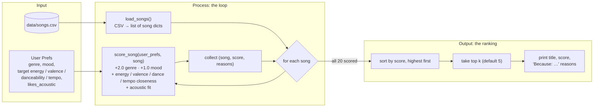

# 🎵 Music Recommender Simulation

## Project Summary

In this project you will build and explain a small music recommender system.

Your goal is to:

- Represent songs and a user "taste profile" as data
- Design a scoring rule that turns that data into recommendations
- Evaluate what your system gets right and wrong
- Reflect on how this mirrors real world AI recommenders

Replace this paragraph with your own summary of what your version does.

---

## How The System Works

**Song features used:** genre, mood, energy, valence, danceability, tempo_bpm, acousticness.

**UserProfile stores:** favorite genre, favorite mood, target energy / valence / danceability / tempo, and whether they like acoustic sound.

### Algorithm Recipe

Each song is scored independently against the user profile (max **7.0** points):

| Rule | Points | Why this weight |
|---|---|---|
| Genre matches `favorite_genre` | **+2.0** | Strongest identity signal. 17 genres across 20 songs, so a match is rare and meaningful. |
| Mood matches `favorite_mood` | **+1.0** | Captures the "vibe," but moods overlap (chill / relaxed / laid-back), so a miss is less damning than a genre miss. |
| Energy closeness | **+1.5 × (1 − \|song − target\|)** | Most spread-out numeric feature (0.22–0.98); separates calm from intense best. |
| Valence closeness | **+0.5 × (1 − \|song − target\|)** | Fine-tuning: happy vs. dark. |
| Danceability closeness | **+0.5 × (1 − \|song − target\|)** | Fine-tuning: groove. |
| Tempo closeness | **+0.5 × (1 − min(\|song − target\| / 100, 1))** | BPM normalized by ~100 (catalog spans 60–168). |
| Acoustic fit | **+1.0 × acousticness** if `likes_acoustic`, else **+1.0 × (1 − acousticness)** | Rewards the texture the user prefers. |

Categorical matches are worth 3.0 of 7.0 points (~43%), and numeric similarity is worth 4.0. A song that matches both genre and mood almost always ranks first. The similarity scores then sort songs that only partly match.

**Choosing songs:** score every song, sort by score from highest to lowest, return the top `k` (default 5), and attach the reasons that added points as the explanation.

### Expected Biases

- **Over-prioritizes genre.** A +2.0 genre match can outweigh a song that fits the user's mood and energy better. For a pop/happy user, *Gym Hero* (pop/intense) outranks *Rooftop Lights* (indie pop/happy). Raising the mood weight to 1.5 does not change that order.
- **Exact string matching is brittle.** "indie pop" gets no credit for "pop", and "relaxed" or "laid-back" gets no credit for "chill". Labels that are close in meaning count as complete misses.
- **Catalog imbalance helps some users more than others.** Lofi has 3 songs, while most genres have only 1. A lofi fan gets a top 3 that all match their genre. A metal or blues fan gets one genre match, and the rest of their list is chosen by numeric similarity alone.
- **Filter bubble.** Because the top results tend to share the user's genre and mood, the system rarely surfaces something different the user might enjoy. It has no diversity or discovery bonus.
- **Fixed, hand-picked weights.** The weights reflect my judgment, not real listening data, and every user gets the same weights. Someone who cares more about mood than genre cannot express that.
- **Acoustic preference is all-or-nothing.** `likes_acoustic` is a true/false setting, so users in the middle are pushed toward one extreme.

### Data Flow



1. **Input:** `main.py` builds the `user_prefs` dict, and `load_songs()` reads `songs.csv` into a list of dicts. Numeric fields are converted to `float`.
2. **Process:** `recommend_songs()` runs `score_song()` on every song. Each call returns a `(score, reasons)` pair, where `reasons` lists what earned points, for example `"genre match (+2.0)"`. The songs are scored independently, so each score depends only on that song and the user.
3. **Output:** the scored songs are sorted from highest to lowest score, the first `k` are kept, and each is returned as `(song, score, explanation)` for `main.py` to print.

---

## Getting Started

### Setup

1. Create a virtual environment (optional but recommended):

   ```bash
   python -m venv .venv
   source .venv/bin/activate      # Mac or Linux
   .venv\Scripts\activate         # Windows

2. Install dependencies

```bash
pip install -r requirements.txt
```

3. Run the app:

```bash
python -m src.main
```

### Running Tests

Run the starter tests with:

```bash
pytest
```

You can add more tests in `tests/test_recommender.py`.

---

## Sample Recommendation Output

Paste a sample of your recommender's output here as a text block so a reader can see what it produces:

```
# e.g.:
# User profile: genre=indie, mood=chill, energy=low
# Recommendations:
#   1. ...
#   2. ...
#   3. ...
```

**Screenshot or video** *(optional)*: <!-- Insert a screenshot or demo video link here -->

---

## Experiments You Tried

Use this section to document the experiments you ran. For example:

- What happened when you changed the weight on genre from 2.0 to 0.5
- What happened when you added tempo or valence to the score
- How did your system behave for different types of users

---

## Limitations and Risks

Summarize some limitations of your recommender.

Examples:

- It only works on a tiny catalog
- It does not understand lyrics or language
- It might over favor one genre or mood

You will go deeper on this in your model card.

---

## Reflection

Read and complete `model_card.md`:

[**Model Card**](model_card.md)

Write 1 to 2 paragraphs here about what you learned:

- about how recommenders turn data into predictions
- about where bias or unfairness could show up in systems like this


