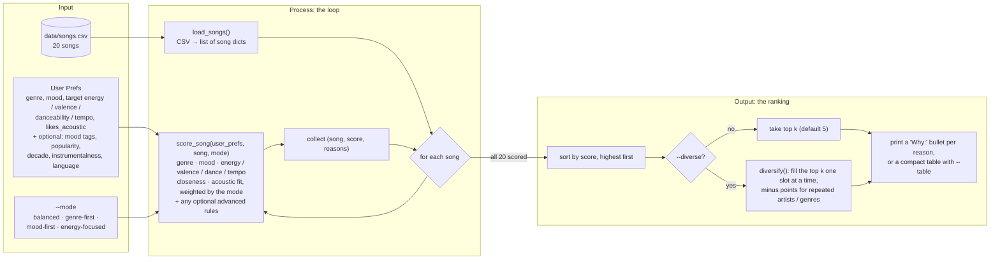

# 🎵 Music Recommender Simulation

## Project Summary

**TuneJudge 1.0** is a small music recommender that runs in the terminal. You describe a listener's taste, and it scores all 20 songs in `data/songs.csv` with a simple points system (out of 7.0). Then it prints the top 5, with a reason for every point awarded. A listener's taste has four parts:

- a favorite genre and mood
- target energy, happiness, danceability and tempo
- whether they like acoustic sound

On top of the basic recommender, this version:

- **Stress-tests the scoring** with 3 everyday listeners and 6 trick profiles built to break it ([Stress Test](#stress-test-diverse-and-adversarial-profiles)).
- **Runs a weight-shift experiment** that can be switched on with one line of code ([Experiments You Tried](#experiments-you-tried)).
- **Adds five optional song features** for Challenge 1 (popularity, release decade, detailed mood tags, instrumentalness and lyrics language), each with its own scoring rule ([Challenge 1](#challenge-1-advanced-song-features)).
- **Offers four scoring modes** for Challenge 2 (balanced, genre-first, mood-first, energy-focused), chosen with `--mode` and built with the Strategy pattern ([Challenge 2](#challenge-2-multiple-scoring-modes)).
- **Adds an optional diversity penalty** for Challenge 3 (`--diverse`), so one artist or genre can't crowd a top 5, plus a check of whether that makes things fairer to artists ([Challenge 3](#challenge-3-diversity-and-fairness-logic)).
- **Prints a compact summary table** for Challenge 4 (`--table`): one row per song with the reasons for its score, plus an overview of each profile's #1 pick ([Challenge 4](#challenge-4-visual-summary-table)).
- **Documents the biases it found** in the [model card](model_card.md). The main one: a gap in the catalog pushes medium-energy listeners toward very calm or very loud songs.

---

## How The System Works

### How Real-World Recommenders Work

Apps like Spotify and YouTube have far more songs and videos than anyone could browse, so they pick a short list for each person. They draw on two kinds of data:

- **What the items are like (content).** Labels such as genre and mood, plus audio measurements such as tempo, energy and danceability. Spotify's public audio-features data used many of the same measurements as my CSV: energy, valence, danceability, acousticness, tempo and instrumentalness. Content lets an app recommend a brand-new song that nobody has played yet.
- **What people do (user history).** Plays, skips, likes, saves, playlist adds, and how long someone keeps listening or watching. *Collaborative filtering* uses this: if many people who love song A also love song B, a new fan of A will probably get B. It finds links that labels miss, but it needs lots of listeners, so new songs and new users are hard to place (the "cold start" problem).

Most real apps combine both. Either way, the work splits into three separate parts:

| Part | What it is | In a real app | In TuneJudge |
|---|---|---|---|
| **Input data** | Facts about the items | Millions of tracks with labels, audio features and play counts | 20 songs in `data/songs.csv` |
| **User preferences** | What this one person wants | Mostly *learned* from their history, and updated as they listen | Typed in by hand as a profile. It never learns. |
| **Ranking and selection** | Turning data + preferences into a short list | Narrow millions of items to a few hundred candidates, score those with a trained model, then re-rank for variety and business rules | Score all 20 songs with fixed, hand-picked weights, sort them, keep the top 5. `--diverse` adds a re-rank for variety. |

TuneJudge is a **content-based** recommender. It only compares song features to the preferences a listener types in. It has no user history, so it can't learn from skips or find "people who liked this also liked" links. That is why every weight below is my own pick, and why a new user with no preferences just gets the first five songs in the file.

### What TuneJudge Uses

**Song features used:** genre, mood, energy, valence, danceability, tempo_bpm, acousticness. Challenge 1 added five optional ones: popularity, release_decade, mood_tags, instrumentalness, lyrics_language (see [Challenge 1](#challenge-1-advanced-song-features)).

**UserProfile stores:** favorite genre, favorite mood, target energy / valence / danceability / tempo, and whether they like acoustic sound. A profile can also set optional advanced preferences: mood tags, popularity, decade, instrumentalness and lyrics language.

### Algorithm Recipe

Each song is scored independently against the user profile (max **7.0** points). This is the default `balanced` scoring mode; [Challenge 2](#challenge-2-multiple-scoring-modes) adds three others that reweight the same rules.

| Rule | Points | Why this weight |
|---|---|---|
| Genre matches `favorite_genre` | **+2.0** | Strongest identity signal. 17 genres across 20 songs, so a match is rare and meaningful. |
| Mood matches `favorite_mood` | **+1.0** | Captures the "vibe," but moods overlap (chill / relaxed / laid-back), so a miss is less damning than a genre miss. |
| Energy closeness | **+1.5 × (1 − \|song − target\|)** | Most spread-out numeric feature (0.22–0.98); separates calm from intense best. |
| Valence closeness | **+0.5 × (1 − \|song − target\|)** | Fine-tuning: happy vs. dark. |
| Danceability closeness | **+0.5 × (1 − \|song − target\|)** | Fine-tuning: groove. |
| Tempo closeness | **+0.5 × (1 − min(\|song − target\| / 100, 1))** | BPM normalized by ~100 (catalog spans 60–168). |
| Acoustic fit | **+1.0 × acousticness** if `likes_acoustic`, else **+1.0 × (1 − acousticness)** | Rewards the texture the user prefers. |

Categorical matches are worth 3.0 of 7.0 points (~43%), and numeric similarity is worth 4.0. A song that matches both genre and mood almost always ranks first. The similarity scores then sort songs that only partly match.

**Choosing songs:** score every song, sort by score from highest to lowest, return the top `k` (default 5), and attach the reasons that added points as the explanation.

### Expected Biases

- **Over-prioritizes genre.** A +2.0 genre match can outweigh a song that fits the user's mood and energy better. For a pop/happy user, *Gym Hero* (pop/intense) outranks *Rooftop Lights* (indie pop/happy). Raising the mood weight to 1.5 does not change that order.
- **Exact string matching is brittle.** "indie pop" gets no credit for "pop", and "relaxed" or "laid-back" gets no credit for "chill". Labels that are close in meaning count as complete misses.
- **Catalog imbalance helps some users more than others.** Lofi has 3 songs, while most genres have only 1. A lofi fan gets a top 3 that all match their genre. A metal or blues fan gets one genre match, and the rest of their list is chosen by numeric similarity alone.
- **Filter bubble.** Because the top results tend to share the user's genre and mood, the system rarely surfaces something different the user might enjoy. It has no diversity or discovery bonus. *(Later, [Challenge 3](#challenge-3-diversity-and-fairness-logic) added an optional diversity penalty. It spreads out artists and genres within one list, but there is still no discovery bonus.)*
- **Fixed, hand-picked weights.** The weights reflect my judgment, not real listening data, and every user gets the same weights. Someone who cares more about mood than genre cannot express that. *(Later, the scoring modes from [Challenge 2](#challenge-2-multiple-scoring-modes) let a listener choose `mood-first`, but all four weight sets are still my own picks.)*
- **Acoustic preference is all-or-nothing.** `likes_acoustic` is a true/false setting, so users in the middle are pushed toward one extreme.

### Data Flow



1. **Input:** `main.py` builds each `user_prefs` dict (`PROFILES`, `EDGE_CASE_PROFILES` and `ADVANCED_PROFILES`) and reads three optional flags:
   - `--mode` picks a scoring mode.
   - `--diverse` turns on the diversity penalty.
   - `--table` switches to the table view.

   `load_songs()` reads `songs.csv` into a list of dicts. Numbers become `int` or `float`, and `mood_tags` is split into a list.
2. **Process:** `recommend_songs()` runs `score_song()` on every song with the chosen mode's weights. Each call returns a `(score, reasons)` pair, where `reasons` lists what earned points, for example `"genre match: pop (+2.0)"`. The optional advanced rules only count if the profile sets their preference. The songs are scored independently, so each score depends only on that song, the user and the mode.
3. **Output:** the scored songs are sorted from highest to lowest score.
   - **Without `--diverse`,** the first `k` are kept.
   - **With `--diverse`,** `diversify()` fills the `k` slots one at a time. A song loses points for each song by the same artist or in the same genre already picked, and each penalty becomes a reason too.

   Each result is returned as `(song, score, explanation)`. `main.py` prints it as bullets, or as a table (`--table`, drawn by `summary_table.py`), with the score shown out of the most that profile could earn in that mode.

---

## Getting Started

### Setup

1. Create a virtual environment (optional but recommended):

   ```bash
   python -m venv .venv
   source .venv/bin/activate      # Mac or Linux
   .venv\Scripts\activate         # Windows
   ```

2. Install dependencies

```bash
pip install -r requirements.txt
```

3. Run the app:

```bash
python -m src.main
```

   To rank with a different strategy, add `--mode` (see [Challenge 2](#challenge-2-multiple-scoring-modes)):

```bash
python -m src.main --mode mood-first
```

   To stop one artist or genre from crowding the top 5, add `--diverse` (see [Challenge 3](#challenge-3-diversity-and-fairness-logic)). It works with any mode:

```bash
python -m src.main --mode mood-first --diverse
```

   For a shorter, easier-to-skim view, add `--table` (see [Challenge 4](#challenge-4-visual-summary-table)):

```bash
python -m src.main --table
```

### Running Tests

Run the tests with:

```bash
pytest
```

The tests live in `tests/`: `test_recommender.py` (the `Recommender` class), `test_advanced_features.py` (Challenge 1), `test_scoring_modes.py` (Challenge 2), `test_diversity.py` (Challenge 3) and `test_summary_table.py` (Challenge 4).

---

## Sample Recommendation Output

The start of `python -m src.main` output, showing the default pop/happy profile and the late-night study (lofi/chill) profile. The rest of the run is in [Stress Test](#stress-test-diverse-and-adversarial-profiles) (the other seven original profiles) and [Challenge 1](#challenge-1-advanced-song-features) (three profiles that use the advanced features).

```
$ python -m src.main
Loading songs from data/songs.csv...
Loaded songs: 20

========================================================================
Profile: Default pop/happy
  genre=pop  mood=happy  likes_acoustic=False
  energy=0.8  valence=0.8  danceability=0.8  tempo=120 BPM
========================================================================
#1  Sunrise City - Neon Echo  [pop / happy]
    Score: 6.76 / 7.00
    Why:
      + genre match: pop (+2.0)
      + mood match: happy (+1.0)
      + energy 0.82 vs target 0.8 (+1.47)
      + valence 0.84 vs target 0.8 (+0.48)
      + danceability 0.79 vs target 0.8 (+0.49)
      + tempo_bpm 118 vs target 120 (+0.49)
      + non-acoustic fit, acousticness 0.18 (+0.82)
    --------------------------------------------------------------------
#2  Gym Hero - Max Pulse  [pop / intense]
    Score: 5.64 / 7.00
    Why:
      + genre match: pop (+2.0)
      + energy 0.93 vs target 0.8 (+1.30)
      + valence 0.77 vs target 0.8 (+0.48)
      + danceability 0.88 vs target 0.8 (+0.46)
      + tempo_bpm 132 vs target 120 (+0.44)
      + non-acoustic fit, acousticness 0.05 (+0.95)
    --------------------------------------------------------------------
#3  Rooftop Lights - Indigo Parade  [indie pop / happy]
    Score: 4.56 / 7.00
    Why:
      + mood match: happy (+1.0)
      + energy 0.76 vs target 0.8 (+1.44)
      + valence 0.81 vs target 0.8 (+0.49)
      + danceability 0.82 vs target 0.8 (+0.49)
      + tempo_bpm 124 vs target 120 (+0.48)
      + non-acoustic fit, acousticness 0.35 (+0.65)
    --------------------------------------------------------------------
#4  Concrete Crown - Blocktide  [hip-hop / confident]
    Score: 3.60 / 7.00
    Why:
      + energy 0.78 vs target 0.8 (+1.47)
      + valence 0.62 vs target 0.8 (+0.41)
      + danceability 0.86 vs target 0.8 (+0.47)
      + tempo_bpm 94 vs target 120 (+0.37)
      + non-acoustic fit, acousticness 0.12 (+0.88)
    --------------------------------------------------------------------
#5  Laser Bloom - Pulsewave  [edm / euphoric]
    Score: 3.58 / 7.00
    Why:
      + energy 0.96 vs target 0.8 (+1.26)
      + valence 0.88 vs target 0.8 (+0.46)
      + danceability 0.93 vs target 0.8 (+0.43)
      + tempo_bpm 128 vs target 120 (+0.46)
      + non-acoustic fit, acousticness 0.03 (+0.97)

========================================================================
Profile: Late-night study (lofi/chill)
  genre=lofi  mood=chill  likes_acoustic=True
  energy=0.4  valence=0.6  danceability=0.55  tempo=80 BPM
========================================================================
#1  Library Rain - Paper Lanterns  [lofi / chill]
    Score: 6.73 / 7.00
    Why:
      + genre match: lofi (+2.0)
      + mood match: chill (+1.0)
      + energy 0.35 vs target 0.4 (+1.42)
      + valence 0.6 vs target 0.6 (+0.50)
      + danceability 0.58 vs target 0.55 (+0.49)
      + tempo_bpm 72 vs target 80 (+0.46)
      + acoustic fit, acousticness 0.86 (+0.86)
    --------------------------------------------------------------------
#2  Midnight Coding - LoRoom  [lofi / chill]
    Score: 6.62 / 7.00
    Why:
      + genre match: lofi (+2.0)
      + mood match: chill (+1.0)
      + energy 0.42 vs target 0.4 (+1.47)
      + valence 0.56 vs target 0.6 (+0.48)
      + danceability 0.62 vs target 0.55 (+0.47)
      + tempo_bpm 78 vs target 80 (+0.49)
      + acoustic fit, acousticness 0.71 (+0.71)
    --------------------------------------------------------------------
#3  Focus Flow - LoRoom  [lofi / focused]
    Score: 5.75 / 7.00
    Why:
      + genre match: lofi (+2.0)
      + energy 0.4 vs target 0.4 (+1.50)
      + valence 0.59 vs target 0.6 (+0.49)
      + danceability 0.6 vs target 0.55 (+0.48)
      + tempo_bpm 80 vs target 80 (+0.50)
      + acoustic fit, acousticness 0.78 (+0.78)
    --------------------------------------------------------------------
#4  Spacewalk Thoughts - Orbit Bloom  [ambient / chill]
    Score: 4.55 / 7.00
    Why:
      + mood match: chill (+1.0)
      + energy 0.28 vs target 0.4 (+1.32)
      + valence 0.65 vs target 0.6 (+0.47)
      + danceability 0.41 vs target 0.55 (+0.43)
      + tempo_bpm 60 vs target 80 (+0.40)
      + acoustic fit, acousticness 0.92 (+0.92)
    --------------------------------------------------------------------
#5  Coffee Shop Stories - Slow Stereo  [jazz / relaxed]
    Score: 3.74 / 7.00
    Why:
      + energy 0.37 vs target 0.4 (+1.46)
      + valence 0.71 vs target 0.6 (+0.45)
      + danceability 0.54 vs target 0.55 (+0.49)
      + tempo_bpm 90 vs target 80 (+0.45)
      + acoustic fit, acousticness 0.89 (+0.89)
```

**Does pop/happy match expectations?** Mostly. *Sunrise City* is the only song that is both pop and happy, and it ranks #1 by more than a full point. Places #4 and #5 go to songs with no label match, *Concrete Crown* and *Laser Bloom*, which make sense as upbeat, danceable, non-acoustic tracks. The surprise is #2: *Gym Hero* (pop / intense) beats *Rooftop Lights* (indie pop / happy), even though Rooftop Lights is closer on mood, energy, valence and tempo. This is the genre over-weighting predicted in [Expected Biases](#expected-biases). The exact genre match earns +2.0, while "indie pop" earns nothing for genre.

**Screenshot or video** *(optional)*: not included. The terminal output above and in the Stress Test section is pasted as text, so it can be searched and compared.

---

## Stress Test: Diverse and Adversarial Profiles

For this stress test, `python -m src.main` runs nine taste profiles through the same 20-song catalog. Three more profiles, added later for Challenge 1, print after these and are covered in [their own section](#challenge-1-advanced-song-features). Of the nine, three are everyday listeners (`PROFILES` in [src/main.py](src/main.py)). Six are adversarial edge cases (`EDGE_CASE_PROFILES`), suggested by an AI coding assistant during a System Evaluation review of `score_song()`. Each one is built to trick the scoring logic or to give it input it does not expect.

| Profile | Type | What it tests |
|---|---|---|
| Default pop/happy | everyday | Baseline: an upbeat, danceable, electronic pop fan. |
| Late-night study (lofi/chill) | everyday | Baseline: calm, warm, acoustic study music. |
| Deep intense rock | everyday | Loud, fast, dark guitar music. The catalog has only one rock song. |
| Edge: high energy + sad mood | conflicting prefs | Mood says "sad", but the numbers ask for loud, fast, electronic music. The only sad song is quiet acoustic folk. |
| Edge: metal genre, calm acoustic numbers | conflicting prefs | Can the +2.0 genre bonus alone pull the one metal song into the top 5 when every number disagrees? |
| Edge: genre typo 'Hip Hop' | brittle labels | The catalog spells it "hip-hop". Matching ignores capitals, but does it ignore a space instead of a hyphen? |
| Edge: likes_acoustic as string | wrong type | An EDM fan whose `likes_acoustic` arrived as the string `"False"`, as it might from a web form. |
| Edge: out-of-range targets | invalid input | Energy 1.5, valence -0.5, danceability 2.0, tempo 300 BPM. Nothing validates prefs. |
| Edge: empty profile (cold start) | missing input | A new user with no preferences at all. |

### Terminal output per profile

Each block below is one consecutive part of a single `python -m src.main` run, split per profile.

#### Default pop/happy

Same as the sample output above. *Gym Hero* (#2) beats *Rooftop Lights* (#3) on the genre bonus alone.

```
========================================================================
Profile: Default pop/happy
  genre=pop  mood=happy  likes_acoustic=False
  energy=0.8  valence=0.8  danceability=0.8  tempo=120 BPM
========================================================================
#1  Sunrise City - Neon Echo  [pop / happy]
    Score: 6.76 / 7.00
    Why:
      + genre match: pop (+2.0)
      + mood match: happy (+1.0)
      + energy 0.82 vs target 0.8 (+1.47)
      + valence 0.84 vs target 0.8 (+0.48)
      + danceability 0.79 vs target 0.8 (+0.49)
      + tempo_bpm 118 vs target 120 (+0.49)
      + non-acoustic fit, acousticness 0.18 (+0.82)
    --------------------------------------------------------------------
#2  Gym Hero - Max Pulse  [pop / intense]
    Score: 5.64 / 7.00
    Why:
      + genre match: pop (+2.0)
      + energy 0.93 vs target 0.8 (+1.30)
      + valence 0.77 vs target 0.8 (+0.48)
      + danceability 0.88 vs target 0.8 (+0.46)
      + tempo_bpm 132 vs target 120 (+0.44)
      + non-acoustic fit, acousticness 0.05 (+0.95)
    --------------------------------------------------------------------
#3  Rooftop Lights - Indigo Parade  [indie pop / happy]
    Score: 4.56 / 7.00
    Why:
      + mood match: happy (+1.0)
      + energy 0.76 vs target 0.8 (+1.44)
      + valence 0.81 vs target 0.8 (+0.49)
      + danceability 0.82 vs target 0.8 (+0.49)
      + tempo_bpm 124 vs target 120 (+0.48)
      + non-acoustic fit, acousticness 0.35 (+0.65)
    --------------------------------------------------------------------
#4  Concrete Crown - Blocktide  [hip-hop / confident]
    Score: 3.60 / 7.00
    Why:
      + energy 0.78 vs target 0.8 (+1.47)
      + valence 0.62 vs target 0.8 (+0.41)
      + danceability 0.86 vs target 0.8 (+0.47)
      + tempo_bpm 94 vs target 120 (+0.37)
      + non-acoustic fit, acousticness 0.12 (+0.88)
    --------------------------------------------------------------------
#5  Laser Bloom - Pulsewave  [edm / euphoric]
    Score: 3.58 / 7.00
    Why:
      + energy 0.96 vs target 0.8 (+1.26)
      + valence 0.88 vs target 0.8 (+0.46)
      + danceability 0.93 vs target 0.8 (+0.43)
      + tempo_bpm 128 vs target 120 (+0.46)
      + non-acoustic fit, acousticness 0.03 (+0.97)
```

#### Late-night study (lofi/chill)

Lofi is the only genre with three songs, so the top 3 are all genre matches.

```
========================================================================
Profile: Late-night study (lofi/chill)
  genre=lofi  mood=chill  likes_acoustic=True
  energy=0.4  valence=0.6  danceability=0.55  tempo=80 BPM
========================================================================
#1  Library Rain - Paper Lanterns  [lofi / chill]
    Score: 6.73 / 7.00
    Why:
      + genre match: lofi (+2.0)
      + mood match: chill (+1.0)
      + energy 0.35 vs target 0.4 (+1.42)
      + valence 0.6 vs target 0.6 (+0.50)
      + danceability 0.58 vs target 0.55 (+0.49)
      + tempo_bpm 72 vs target 80 (+0.46)
      + acoustic fit, acousticness 0.86 (+0.86)
    --------------------------------------------------------------------
#2  Midnight Coding - LoRoom  [lofi / chill]
    Score: 6.62 / 7.00
    Why:
      + genre match: lofi (+2.0)
      + mood match: chill (+1.0)
      + energy 0.42 vs target 0.4 (+1.47)
      + valence 0.56 vs target 0.6 (+0.48)
      + danceability 0.62 vs target 0.55 (+0.47)
      + tempo_bpm 78 vs target 80 (+0.49)
      + acoustic fit, acousticness 0.71 (+0.71)
    --------------------------------------------------------------------
#3  Focus Flow - LoRoom  [lofi / focused]
    Score: 5.75 / 7.00
    Why:
      + genre match: lofi (+2.0)
      + energy 0.4 vs target 0.4 (+1.50)
      + valence 0.59 vs target 0.6 (+0.49)
      + danceability 0.6 vs target 0.55 (+0.48)
      + tempo_bpm 80 vs target 80 (+0.50)
      + acoustic fit, acousticness 0.78 (+0.78)
    --------------------------------------------------------------------
#4  Spacewalk Thoughts - Orbit Bloom  [ambient / chill]
    Score: 4.55 / 7.00
    Why:
      + mood match: chill (+1.0)
      + energy 0.28 vs target 0.4 (+1.32)
      + valence 0.65 vs target 0.6 (+0.47)
      + danceability 0.41 vs target 0.55 (+0.43)
      + tempo_bpm 60 vs target 80 (+0.40)
      + acoustic fit, acousticness 0.92 (+0.92)
    --------------------------------------------------------------------
#5  Coffee Shop Stories - Slow Stereo  [jazz / relaxed]
    Score: 3.74 / 7.00
    Why:
      + energy 0.37 vs target 0.4 (+1.46)
      + valence 0.71 vs target 0.6 (+0.45)
      + danceability 0.54 vs target 0.55 (+0.49)
      + tempo_bpm 90 vs target 80 (+0.45)
      + acoustic fit, acousticness 0.89 (+0.89)
```

#### Deep intense rock

There is only one rock song. After *Storm Runner* (6.80) the score drops 2.3 points, and #2 to #5 are pop, metal, EDM and synthwave.

```
========================================================================
Profile: Deep intense rock
  genre=rock  mood=intense  likes_acoustic=False
  energy=0.9  valence=0.4  danceability=0.6  tempo=150 BPM
========================================================================
#1  Storm Runner - Voltline  [rock / intense]
    Score: 6.80 / 7.00
    Why:
      + genre match: rock (+2.0)
      + mood match: intense (+1.0)
      + energy 0.91 vs target 0.9 (+1.48)
      + valence 0.48 vs target 0.4 (+0.46)
      + danceability 0.66 vs target 0.6 (+0.47)
      + tempo_bpm 152 vs target 150 (+0.49)
      + non-acoustic fit, acousticness 0.1 (+0.90)
    --------------------------------------------------------------------
#2  Gym Hero - Max Pulse  [pop / intense]
    Score: 4.49 / 7.00
    Why:
      + mood match: intense (+1.0)
      + energy 0.93 vs target 0.9 (+1.46)
      + valence 0.77 vs target 0.4 (+0.32)
      + danceability 0.88 vs target 0.6 (+0.36)
      + tempo_bpm 132 vs target 150 (+0.41)
      + non-acoustic fit, acousticness 0.05 (+0.95)
    --------------------------------------------------------------------
#3  Iron Cathedral - Grimhollow  [metal / angry]
    Score: 3.58 / 7.00
    Why:
      + energy 0.98 vs target 0.9 (+1.38)
      + valence 0.22 vs target 0.4 (+0.41)
      + danceability 0.45 vs target 0.6 (+0.43)
      + tempo_bpm 168 vs target 150 (+0.41)
      + non-acoustic fit, acousticness 0.04 (+0.96)
    --------------------------------------------------------------------
#4  Laser Bloom - Pulsewave  [edm / euphoric]
    Score: 3.37 / 7.00
    Why:
      + energy 0.96 vs target 0.9 (+1.41)
      + valence 0.88 vs target 0.4 (+0.26)
      + danceability 0.93 vs target 0.6 (+0.33)
      + tempo_bpm 128 vs target 150 (+0.39)
      + non-acoustic fit, acousticness 0.03 (+0.97)
    --------------------------------------------------------------------
#5  Night Drive Loop - Neon Echo  [synthwave / moody]
    Score: 3.25 / 7.00
    Why:
      + energy 0.75 vs target 0.9 (+1.27)
      + valence 0.49 vs target 0.4 (+0.46)
      + danceability 0.73 vs target 0.6 (+0.43)
      + tempo_bpm 110 vs target 150 (+0.30)
      + non-acoustic fit, acousticness 0.22 (+0.78)
```

#### Edge: high energy + sad mood

No `mood match: sad` line appears anywhere in the top 5.

```
========================================================================
Profile: Edge: high energy + sad mood
  genre=-  mood=sad  likes_acoustic=False
  energy=0.9  valence=0.2  danceability=0.5  tempo=150 BPM
========================================================================
#1  Iron Cathedral - Grimhollow  [metal / angry]
    Score: 3.72 / 7.00
    Why:
      + energy 0.98 vs target 0.9 (+1.38)
      + valence 0.22 vs target 0.2 (+0.49)
      + danceability 0.45 vs target 0.5 (+0.47)
      + tempo_bpm 168 vs target 150 (+0.41)
      + non-acoustic fit, acousticness 0.04 (+0.96)
    --------------------------------------------------------------------
#2  Storm Runner - Voltline  [rock / intense]
    Score: 3.65 / 7.00
    Why:
      + energy 0.91 vs target 0.9 (+1.48)
      + valence 0.48 vs target 0.2 (+0.36)
      + danceability 0.66 vs target 0.5 (+0.42)
      + tempo_bpm 152 vs target 150 (+0.49)
      + non-acoustic fit, acousticness 0.1 (+0.90)
    --------------------------------------------------------------------
#3  Gym Hero - Max Pulse  [pop / intense]
    Score: 3.34 / 7.00
    Why:
      + energy 0.93 vs target 0.9 (+1.46)
      + valence 0.77 vs target 0.2 (+0.21)
      + danceability 0.88 vs target 0.5 (+0.31)
      + tempo_bpm 132 vs target 150 (+0.41)
      + non-acoustic fit, acousticness 0.05 (+0.95)
    --------------------------------------------------------------------
#4  Laser Bloom - Pulsewave  [edm / euphoric]
    Score: 3.21 / 7.00
    Why:
      + energy 0.96 vs target 0.9 (+1.41)
      + valence 0.88 vs target 0.2 (+0.16)
      + danceability 0.93 vs target 0.5 (+0.28)
      + tempo_bpm 128 vs target 150 (+0.39)
      + non-acoustic fit, acousticness 0.03 (+0.97)
    --------------------------------------------------------------------
#5  Night Drive Loop - Neon Echo  [synthwave / moody]
    Score: 3.09 / 7.00
    Why:
      + energy 0.75 vs target 0.9 (+1.27)
      + valence 0.49 vs target 0.2 (+0.35)
      + danceability 0.73 vs target 0.5 (+0.39)
      + tempo_bpm 110 vs target 150 (+0.30)
      + non-acoustic fit, acousticness 0.22 (+0.78)
```

#### Edge: metal genre, calm acoustic numbers

No `genre match: metal` line appears. Every song in the list is quiet and acoustic.

```
========================================================================
Profile: Edge: metal genre, calm acoustic numbers
  genre=metal  mood=peaceful  likes_acoustic=True
  energy=0.2  valence=0.8  danceability=0.4  tempo=70 BPM
========================================================================
#1  Spacewalk Thoughts - Orbit Bloom  [ambient / chill]
    Score: 3.67 / 7.00
    Why:
      + energy 0.28 vs target 0.2 (+1.38)
      + valence 0.65 vs target 0.8 (+0.42)
      + danceability 0.41 vs target 0.4 (+0.49)
      + tempo_bpm 60 vs target 70 (+0.45)
      + acoustic fit, acousticness 0.92 (+0.92)
    --------------------------------------------------------------------
#2  Moonlit Sonata Redux - Elena Varga  [classical / melancholic]
    Score: 3.56 / 7.00
    Why:
      + energy 0.22 vs target 0.2 (+1.47)
      + valence 0.28 vs target 0.8 (+0.24)
      + danceability 0.2 vs target 0.4 (+0.40)
      + tempo_bpm 66 vs target 70 (+0.48)
      + acoustic fit, acousticness 0.97 (+0.97)
    --------------------------------------------------------------------
#3  Library Rain - Paper Lanterns  [lofi / chill]
    Score: 3.44 / 7.00
    Why:
      + energy 0.35 vs target 0.2 (+1.28)
      + valence 0.6 vs target 0.8 (+0.40)
      + danceability 0.58 vs target 0.4 (+0.41)
      + tempo_bpm 72 vs target 70 (+0.49)
      + acoustic fit, acousticness 0.86 (+0.86)
    --------------------------------------------------------------------
#4  Coffee Shop Stories - Slow Stereo  [jazz / relaxed]
    Score: 3.42 / 7.00
    Why:
      + energy 0.37 vs target 0.2 (+1.25)
      + valence 0.71 vs target 0.8 (+0.45)
      + danceability 0.54 vs target 0.4 (+0.43)
      + tempo_bpm 90 vs target 70 (+0.40)
      + acoustic fit, acousticness 0.89 (+0.89)
    --------------------------------------------------------------------
#5  Pinewood Letters - Hollow Fern  [folk / sad]
    Score: 3.39 / 7.00
    Why:
      + energy 0.3 vs target 0.2 (+1.35)
      + valence 0.25 vs target 0.8 (+0.22)
      + danceability 0.39 vs target 0.4 (+0.49)
      + tempo_bpm 88 vs target 70 (+0.41)
      + acoustic fit, acousticness 0.91 (+0.91)
```

#### Edge: genre typo 'Hip Hop'

*Concrete Crown* gets `mood match: confident` (capital C was ignored) but no genre match line.

```
========================================================================
Profile: Edge: genre typo 'Hip Hop'
  genre=Hip Hop  mood=Confident  likes_acoustic=False
  energy=0.8  valence=0.6  danceability=0.85  tempo=95 BPM
========================================================================
#1  Concrete Crown - Blocktide  [hip-hop / confident]
    Score: 4.83 / 7.00
    Why:
      + mood match: confident (+1.0)
      + energy 0.78 vs target 0.8 (+1.47)
      + valence 0.62 vs target 0.6 (+0.49)
      + danceability 0.86 vs target 0.85 (+0.49)
      + tempo_bpm 94 vs target 95 (+0.49)
      + non-acoustic fit, acousticness 0.12 (+0.88)
    --------------------------------------------------------------------
#2  Sunrise City - Neon Echo  [pop / happy]
    Score: 3.53 / 7.00
    Why:
      + energy 0.82 vs target 0.8 (+1.47)
      + valence 0.84 vs target 0.6 (+0.38)
      + danceability 0.79 vs target 0.85 (+0.47)
      + tempo_bpm 118 vs target 95 (+0.39)
      + non-acoustic fit, acousticness 0.18 (+0.82)
    --------------------------------------------------------------------
#3  Fuego Lento - Marisol Cruz  [latin / playful]
    Score: 3.52 / 7.00
    Why:
      + energy 0.81 vs target 0.8 (+1.48)
      + valence 0.9 vs target 0.6 (+0.35)
      + danceability 0.89 vs target 0.85 (+0.48)
      + tempo_bpm 100 vs target 95 (+0.47)
      + non-acoustic fit, acousticness 0.27 (+0.73)
    --------------------------------------------------------------------
#4  Night Drive Loop - Neon Echo  [synthwave / moody]
    Score: 3.51 / 7.00
    Why:
      + energy 0.75 vs target 0.8 (+1.42)
      + valence 0.49 vs target 0.6 (+0.45)
      + danceability 0.73 vs target 0.85 (+0.44)
      + tempo_bpm 110 vs target 95 (+0.42)
      + non-acoustic fit, acousticness 0.22 (+0.78)
    --------------------------------------------------------------------
#5  Gym Hero - Max Pulse  [pop / intense]
    Score: 3.47 / 7.00
    Why:
      + energy 0.93 vs target 0.8 (+1.30)
      + valence 0.77 vs target 0.6 (+0.41)
      + danceability 0.88 vs target 0.85 (+0.48)
      + tempo_bpm 132 vs target 95 (+0.32)
      + non-acoustic fit, acousticness 0.05 (+0.95)
```

#### Edge: likes_acoustic as string

The header shows `likes_acoustic='False'` in quotes, a string. Every reason then says `acoustic fit` instead of `non-acoustic fit`.

```
========================================================================
Profile: Edge: likes_acoustic as string
  genre=edm  mood=euphoric  likes_acoustic='False'
  energy=0.95  valence=0.85  danceability=0.9  tempo=128 BPM
========================================================================
#1  Laser Bloom - Pulsewave  [edm / euphoric]
    Score: 5.99 / 7.00
    Why:
      + genre match: edm (+2.0)
      + mood match: euphoric (+1.0)
      + energy 0.96 vs target 0.95 (+1.48)
      + valence 0.88 vs target 0.85 (+0.48)
      + danceability 0.93 vs target 0.9 (+0.48)
      + tempo_bpm 128 vs target 128 (+0.50)
      + acoustic fit, acousticness 0.03 (+0.03)
    --------------------------------------------------------------------
#2  Rooftop Lights - Indigo Parade  [indie pop / happy]
    Score: 2.99 / 7.00
    Why:
      + energy 0.76 vs target 0.95 (+1.22)
      + valence 0.81 vs target 0.85 (+0.48)
      + danceability 0.82 vs target 0.9 (+0.46)
      + tempo_bpm 124 vs target 128 (+0.48)
      + acoustic fit, acousticness 0.35 (+0.35)
    --------------------------------------------------------------------
#3  Gym Hero - Max Pulse  [pop / intense]
    Score: 2.95 / 7.00
    Why:
      + energy 0.93 vs target 0.95 (+1.47)
      + valence 0.77 vs target 0.85 (+0.46)
      + danceability 0.88 vs target 0.9 (+0.49)
      + tempo_bpm 132 vs target 128 (+0.48)
      + acoustic fit, acousticness 0.05 (+0.05)
    --------------------------------------------------------------------
#4  Fuego Lento - Marisol Cruz  [latin / playful]
    Score: 2.89 / 7.00
    Why:
      + energy 0.81 vs target 0.95 (+1.29)
      + valence 0.9 vs target 0.85 (+0.47)
      + danceability 0.89 vs target 0.9 (+0.49)
      + tempo_bpm 100 vs target 128 (+0.36)
      + acoustic fit, acousticness 0.27 (+0.27)
    --------------------------------------------------------------------
#5  Sunrise City - Neon Echo  [pop / happy]
    Score: 2.88 / 7.00
    Why:
      + energy 0.82 vs target 0.95 (+1.30)
      + valence 0.84 vs target 0.85 (+0.49)
      + danceability 0.79 vs target 0.9 (+0.45)
      + tempo_bpm 118 vs target 128 (+0.45)
      + acoustic fit, acousticness 0.18 (+0.18)
```

#### Edge: out-of-range targets

Every danceability and tempo line earns `+0.00`, and the best score is 0.86 out of 7.

```
========================================================================
Profile: Edge: out-of-range targets
  genre=-  mood=-  likes_acoustic=-
  energy=1.5  valence=-0.5  danceability=2.0  tempo=300 BPM
========================================================================
#1  Iron Cathedral - Grimhollow  [metal / angry]
    Score: 0.86 / 7.00
    Why:
      + energy 0.98 vs target 1.5 (+0.72)
      + valence 0.22 vs target -0.5 (+0.14)
      + danceability 0.45 vs target 2 (+0.00)
      + tempo_bpm 168 vs target 300 (+0.00)
    --------------------------------------------------------------------
#2  Laser Bloom - Pulsewave  [edm / euphoric]
    Score: 0.69 / 7.00
    Why:
      + energy 0.96 vs target 1.5 (+0.69)
      + valence 0.88 vs target -0.5 (+0.00)
      + danceability 0.93 vs target 2 (+0.00)
      + tempo_bpm 128 vs target 300 (+0.00)
    --------------------------------------------------------------------
#3  Gym Hero - Max Pulse  [pop / intense]
    Score: 0.65 / 7.00
    Why:
      + energy 0.93 vs target 1.5 (+0.65)
      + valence 0.77 vs target -0.5 (+0.00)
      + danceability 0.88 vs target 2 (+0.00)
      + tempo_bpm 132 vs target 300 (+0.00)
    --------------------------------------------------------------------
#4  Storm Runner - Voltline  [rock / intense]
    Score: 0.62 / 7.00
    Why:
      + energy 0.91 vs target 1.5 (+0.61)
      + valence 0.48 vs target -0.5 (+0.01)
      + danceability 0.66 vs target 2 (+0.00)
      + tempo_bpm 152 vs target 300 (+0.00)
    --------------------------------------------------------------------
#5  Sunrise City - Neon Echo  [pop / happy]
    Score: 0.48 / 7.00
    Why:
      + energy 0.82 vs target 1.5 (+0.48)
      + valence 0.84 vs target -0.5 (+0.00)
      + danceability 0.79 vs target 2 (+0.00)
      + tempo_bpm 118 vs target 300 (+0.00)
```

#### Edge: empty profile (cold start)

Every score is 0.00, and the order is just the first five rows of `data/songs.csv`.

```
========================================================================
Profile: Edge: empty profile (cold start)
  genre=-  mood=-  likes_acoustic=-
  energy=-  valence=-  danceability=-  tempo=- BPM
========================================================================
#1  Sunrise City - Neon Echo  [pop / happy]
    Score: 0.00 / 7.00
    Why:
      + no preferences matched
    --------------------------------------------------------------------
#2  Midnight Coding - LoRoom  [lofi / chill]
    Score: 0.00 / 7.00
    Why:
      + no preferences matched
    --------------------------------------------------------------------
#3  Storm Runner - Voltline  [rock / intense]
    Score: 0.00 / 7.00
    Why:
      + no preferences matched
    --------------------------------------------------------------------
#4  Library Rain - Paper Lanterns  [lofi / chill]
    Score: 0.00 / 7.00
    Why:
      + no preferences matched
    --------------------------------------------------------------------
#5  Gym Hero - Max Pulse  [pop / intense]
    Score: 0.00 / 7.00
    Why:
      + no preferences matched
```

### What the stress test revealed

1. **One label loses to the numbers.** When a stated genre or mood disagrees with the numeric targets, the numbers win. *Pinewood Letters*, the only sad song, ranks #9 (2.80) for the "high energy + sad" user. Its +1.0 mood bonus cannot make up for a 0.6 energy gap and a 62 BPM tempo gap. *Iron Cathedral*, the only metal song, ranks #9 (3.07) for the metal fan, even with the +2.0 genre bonus. The pop profile showed the opposite case: when the numbers are already close, the genre bonus decides the order (*Gym Hero* over *Rooftop Lights*). In both cases the user is never told that their genre or mood was overruled.
2. **Label matching is brittle.** Capital letters are ignored ("Confident" matched "confident"), but "Hip Hop" is not "hip-hop". The typo cost *Concrete Crown* the full genre bonus (6.83 with the correct spelling, 4.83 with the typo). It stayed #1 only because no other song came close. Its lead over #2 shrank from 3.30 points to 1.30.
3. **Wrong types are accepted silently.** Python treats any non-empty string as true, so `"False"` turned an EDM fan into an acoustic fan. *Laser Bloom* fell from 6.92 (with the boolean `False`) to 5.99. *Storm Runner* dropped out of the top 5, and *Rooftop Lights*, the most acoustic upbeat song, jumped to #2.
4. **Out-of-range numbers neither crash nor warn.** The `min(..., 1.0)` cap in `score_song()` keeps every rule at 0 points or more, so nothing breaks. But danceability 2.0 and 300 BPM give every song +0.00, so the ranking comes down to "highest energy first", with no sign that the input was invalid.
5. **Cold start falls back to file order.** With no preferences, every song ties at 0.00, and the stable sort keeps CSV order. *Sunrise City* is the "default" recommendation only because it is row 1 of `songs.csv`.
6. **Thin genres create score cliffs.** The rock fan's #1 scores 6.80 and #2 scores 4.49. Everything after the single rock song is chosen by mood or energy alone. The lofi fan, with three lofi songs to choose from, gets a full top 3 of genre matches.
7. **Explanations list rules that barely helped.** Lines like `danceability 0.45 vs target 2 (+0.00)` and `acoustic fit, acousticness 0.03 (+0.03)` appear as "+" reasons, although they are really reasons the song is a poor fit.

---

## Experiments You Tried

### Experiment: Weight Shift (energy ×2, genre ×½)

**What I changed.** One switch in [src/recommender.py](src/recommender.py): setting `WEIGHT_SHIFT_EXPERIMENT = True` doubles energy's weight (1.5 → 3.0) and halves genre's (2.0 → 1.0). Every other rule stays the same. The switch is set back to `False` afterwards, so all other output in this README still shows the baseline weights. To rerun the experiment, set the switch to `True` and run `python -m src.main`. The output then starts with a `*** WEIGHT SHIFT EXPERIMENT ***` line.

**Is the math still valid?** Yes. I checked four things:

- **The maximum is 7.5.** The top possible score goes from 7.0 to 7.5 (1 + 1 + 1 + 3.0 + 0.5 × 3). `MAX_SCORE` is calculated from the weights, so the output shows "/ 7.50" with no other edits. A made-up song that matches a profile exactly scores exactly 7.50.
- **No rule goes out of bounds.** Every rule still earns between 0 and its weight, because the distance is capped at 1. Across all 180 profile/song pairs, scores ranged from 0.00 to 7.29, and no rule went negative or above its cap.
- **The balance of power shifts.** Genre + mood drop from 43% of the maximum score to 27%. Energy rises from 21% to 40%.
- **Compare rankings, not scores.** Raw scores can't be compared between the two runs because the maximums differ.

**How the top 5 changed**

| Profile | What changed | More accurate, or just different? |
|---|---|---|
| Default pop/happy | *Rooftop Lights* (indie pop/happy) moves up to #2, passing *Gym Hero* (pop/intense) 6.00 to 5.95. *Fuego Lento* replaces *Laser Bloom* at #5. | **More accurate.** This fixes the genre bias seen in the Sample Output: the song that fits the mood and the numbers better now wins. |
| Late-night study (lofi/chill) | No change. | Same. The three lofi songs fit every rule well, so the weights don't matter. |
| Deep intense rock | *Sunrise City* (pop/happy) replaces *Night Drive Loop* (synthwave/moody) at #5. | **Less accurate.** A bright, happy pop song now appears for a dark rock fan. Its energy (0.82, vs. 0.75 for *Night Drive Loop*) is now worth more than its poor valence fit (0.84 vs. a target of 0.4). |
| Edge: high energy + sad mood | *Storm Runner* and *Iron Cathedral* swap #1 and #2. *Sunrise City* replaces *Night Drive Loop* at #5. | **Less accurate.** The darkest loud song loses #1 on energy, and a happy song enters a sad listener's list. |
| Edge: metal genre, calm acoustic numbers | *Pinewood Letters* moves from #5 to #3. | Just different. There is still no metal song in the list. |
| Edge: genre typo 'Hip Hop' | No change in order. | Same. The typo now costs 1.0 point instead of 2.0. |
| Edge: likes_acoustic as string | *Gym Hero* passes *Rooftop Lights* for #2, and #4 and #5 swap. | Just different. The string `"False"` bug is unaffected. |
| Edge: out-of-range targets | No change. | Same. This ranking was already decided by energy alone. |
| Edge: empty profile (cold start) | No change. | Same. Every score is still 0.00. |

**Verdict: mostly different, not more accurate.** The experiment fixed the one problem it targeted: with genre halved, *Rooftop Lights* finally beats *Gym Hero* for the pop/happy fan. But it created a new bias. Energy is now 40% of the score, and it measures only how loud a song is, not how it feels, so loud songs became interchangeable. *Sunrise City*, a bright happy pop song, now appears in 7 of the 9 top-5 lists (up from 5), including the dark rock fan's and the sad listener's. *Gym Hero* still appears in 7 of 9. The "same songs keep showing up" problem from Step 2 got worse, not better. I kept the baseline weights. A better fix for the pop/happy problem would be partial credit for related genres ("indie pop" earning some credit for "pop") rather than shrinking genre for everyone.

**Terminal output with the experiment on.** These are two profiles from the experimental run: one that improved (pop/happy) and one that got worse (deep intense rock). The baseline output for both is in the [Stress Test](#stress-test-diverse-and-adversarial-profiles) section above.

```
$ python -m src.main        # with WEIGHT_SHIFT_EXPERIMENT = True
Loading songs from data/songs.csv...
Loaded songs: 20

*** WEIGHT SHIFT EXPERIMENT: genre +1.0, energy x3.0, max score 7.50 ***

========================================================================
Profile: Default pop/happy
  genre=pop  mood=happy  likes_acoustic=False
  energy=0.8  valence=0.8  danceability=0.8  tempo=120 BPM
========================================================================
#1  Sunrise City - Neon Echo  [pop / happy]
    Score: 7.23 / 7.50
    Why:
      + genre match: pop (+1.0)
      + mood match: happy (+1.0)
      + energy 0.82 vs target 0.8 (+2.94)
      + valence 0.84 vs target 0.8 (+0.48)
      + danceability 0.79 vs target 0.8 (+0.49)
      + tempo_bpm 118 vs target 120 (+0.49)
      + non-acoustic fit, acousticness 0.18 (+0.82)
    --------------------------------------------------------------------
#2  Rooftop Lights - Indigo Parade  [indie pop / happy]
    Score: 6.00 / 7.50
    Why:
      + mood match: happy (+1.0)
      + energy 0.76 vs target 0.8 (+2.88)
      + valence 0.81 vs target 0.8 (+0.49)
      + danceability 0.82 vs target 0.8 (+0.49)
      + tempo_bpm 124 vs target 120 (+0.48)
      + non-acoustic fit, acousticness 0.35 (+0.65)
    --------------------------------------------------------------------
#3  Gym Hero - Max Pulse  [pop / intense]
    Score: 5.95 / 7.50
    Why:
      + genre match: pop (+1.0)
      + energy 0.93 vs target 0.8 (+2.61)
      + valence 0.77 vs target 0.8 (+0.48)
      + danceability 0.88 vs target 0.8 (+0.46)
      + tempo_bpm 132 vs target 120 (+0.44)
      + non-acoustic fit, acousticness 0.05 (+0.95)
    --------------------------------------------------------------------
#4  Concrete Crown - Blocktide  [hip-hop / confident]
    Score: 5.07 / 7.50
    Why:
      + energy 0.78 vs target 0.8 (+2.94)
      + valence 0.62 vs target 0.8 (+0.41)
      + danceability 0.86 vs target 0.8 (+0.47)
      + tempo_bpm 94 vs target 120 (+0.37)
      + non-acoustic fit, acousticness 0.12 (+0.88)
    --------------------------------------------------------------------
#5  Fuego Lento - Marisol Cruz  [latin / playful]
    Score: 5.01 / 7.50
    Why:
      + energy 0.81 vs target 0.8 (+2.97)
      + valence 0.9 vs target 0.8 (+0.45)
      + danceability 0.89 vs target 0.8 (+0.46)
      + tempo_bpm 100 vs target 120 (+0.40)
      + non-acoustic fit, acousticness 0.27 (+0.73)
```

```
========================================================================
Profile: Deep intense rock
  genre=rock  mood=intense  likes_acoustic=False
  energy=0.9  valence=0.4  danceability=0.6  tempo=150 BPM
========================================================================
#1  Storm Runner - Voltline  [rock / intense]
    Score: 7.29 / 7.50
    Why:
      + genre match: rock (+1.0)
      + mood match: intense (+1.0)
      + energy 0.91 vs target 0.9 (+2.97)
      + valence 0.48 vs target 0.4 (+0.46)
      + danceability 0.66 vs target 0.6 (+0.47)
      + tempo_bpm 152 vs target 150 (+0.49)
      + non-acoustic fit, acousticness 0.1 (+0.90)
    --------------------------------------------------------------------
#2  Gym Hero - Max Pulse  [pop / intense]
    Score: 5.95 / 7.50
    Why:
      + mood match: intense (+1.0)
      + energy 0.93 vs target 0.9 (+2.91)
      + valence 0.77 vs target 0.4 (+0.32)
      + danceability 0.88 vs target 0.6 (+0.36)
      + tempo_bpm 132 vs target 150 (+0.41)
      + non-acoustic fit, acousticness 0.05 (+0.95)
    --------------------------------------------------------------------
#3  Iron Cathedral - Grimhollow  [metal / angry]
    Score: 4.97 / 7.50
    Why:
      + energy 0.98 vs target 0.9 (+2.76)
      + valence 0.22 vs target 0.4 (+0.41)
      + danceability 0.45 vs target 0.6 (+0.43)
      + tempo_bpm 168 vs target 150 (+0.41)
      + non-acoustic fit, acousticness 0.04 (+0.96)
    --------------------------------------------------------------------
#4  Laser Bloom - Pulsewave  [edm / euphoric]
    Score: 4.78 / 7.50
    Why:
      + energy 0.96 vs target 0.9 (+2.82)
      + valence 0.88 vs target 0.4 (+0.26)
      + danceability 0.93 vs target 0.6 (+0.33)
      + tempo_bpm 128 vs target 150 (+0.39)
      + non-acoustic fit, acousticness 0.03 (+0.97)
    --------------------------------------------------------------------
#5  Sunrise City - Neon Echo  [pop / happy]
    Score: 4.60 / 7.50
    Why:
      + energy 0.82 vs target 0.9 (+2.76)
      + valence 0.84 vs target 0.4 (+0.28)
      + danceability 0.79 vs target 0.6 (+0.40)
      + tempo_bpm 118 vs target 150 (+0.34)
      + non-acoustic fit, acousticness 0.18 (+0.82)
```

---

## Challenge 1: Advanced Song Features

**What I added.** Five new columns in [data/songs.csv](data/songs.csv), each with a scoring rule in [src/recommender.py](src/recommender.py):

| Song attribute | Values | Listener preference | Rule (max points) |
|---|---|---|---|
| `popularity` | 0–100 (made up) | `target_popularity` | Closeness, gap ÷ 100 (**0.5**). A low target favors lesser-known songs. |
| `release_decade` | 1960–2020 | `favorite_decade` | Closeness, gap ÷ 30 years (**0.5**). Same decade earns 0.5, 10 years off 0.33, 30+ years off 0. |
| `mood_tags` | 3 detailed tags, e.g. `rainy\|cozy\|dreamy` | `preferred_mood_tags` (a list) | **Partial credit** (**1.0**): the share of the wanted tags the song has. 1 of 2 tags earns 0.5. |
| `instrumentalness` | 0–1 (0 = all vocals) | `target_instrumentalness` | Closeness (**0.5**). |
| `lyrics_language` | english, spanish, instrumental | `preferred_language` | Exact match (**0.5**). |

**Why the rules are opt-in.** Each new rule only scores when a profile sets its preference. The nine original profiles set none of them, so their output is byte-for-byte the same as before, and every earlier result in this README and the model card still holds. Scores are shown out of the most *that profile* could earn: 7.00 for the original profiles, and up to 10.00 for a profile that uses all five new preferences.

**Three new profiles** (`ADVANCED_PROFILES` in [src/main.py](src/main.py)) print after the original nine:

| Profile | What it adds | What happened |
|---|---|---|
| Advanced: happy pop + mood tags | Default pop/happy + tags `upbeat, sunny` | **Helped, but didn't fix it.** *Rooftop Lights* matches both tags and *Gym Hero* only one, so *Gym Hero*'s lead shrank from 1.08 to 0.58 points. It still ranks #2. *Fuego Lento* ("sunny") entered at #4. |
| Advanced: hidden-gem study listener | Lofi/chill + popularity 30, instrumentalness 0.95, tags `cozy, rainy`, language instrumental | **Same order as before.** Lofi songs are already instrumental, so those rules overlap with genre. Popularity is worth only 0.5, so the "hidden gem" wish barely registers (+0.34 to +0.46 for every song). Only the tags mattered, widening *Library Rain*'s lead from 0.11 to 0.67. |
| Advanced: 90s throwback, English lyrics | No genre or mood. Mid-tempo numbers + decade 1990, English, tags `nostalgic, warm` | **Worked from the new features alone.** *Dusty Highway Home* (1990s, nostalgic, warm, English) is #1 and *Velvet Hours* (1990s) is #2. But at 0.5 points, the decade is only a tie-breaker: *Crossroads Whiskey* (1960s) still makes #5 on the numbers. |

**Verdict.** The new features work as designed. Tags (1.0 points, partial credit) had the most effect. At 0.5 points each, popularity, decade and instrumentalness are tie-breakers, not drivers. Two limits to keep in mind: *Fuego Lento* is the only Spanish-language song, and the popularity numbers are invented.

**Terminal output** (the last three profiles of a `python -m src.main` run):

```
========================================================================
Profile: Advanced: happy pop + mood tags
  genre=pop  mood=happy  likes_acoustic=False
  energy=0.8  valence=0.8  danceability=0.8  tempo=120 BPM
  tags=upbeat, sunny  popularity=-  decade=-  instrumentalness=-  language=-
========================================================================
#1  Sunrise City - Neon Echo  [pop / happy]
    Score: 7.76 / 8.00
    Why:
      + genre match: pop (+2.0)
      + mood match: happy (+1.0)
      + energy 0.82 vs target 0.8 (+1.47)
      + valence 0.84 vs target 0.8 (+0.48)
      + danceability 0.79 vs target 0.8 (+0.49)
      + tempo_bpm 118 vs target 120 (+0.49)
      + non-acoustic fit, acousticness 0.18 (+0.82)
      + mood tags matched: upbeat, sunny (2 of 2) (+1.00)
    --------------------------------------------------------------------
#2  Gym Hero - Max Pulse  [pop / intense]
    Score: 6.14 / 8.00
    Why:
      + genre match: pop (+2.0)
      + energy 0.93 vs target 0.8 (+1.30)
      + valence 0.77 vs target 0.8 (+0.48)
      + danceability 0.88 vs target 0.8 (+0.46)
      + tempo_bpm 132 vs target 120 (+0.44)
      + non-acoustic fit, acousticness 0.05 (+0.95)
      + mood tags matched: upbeat (1 of 2) (+0.50)
    --------------------------------------------------------------------
#3  Rooftop Lights - Indigo Parade  [indie pop / happy]
    Score: 5.56 / 8.00
    Why:
      + mood match: happy (+1.0)
      + energy 0.76 vs target 0.8 (+1.44)
      + valence 0.81 vs target 0.8 (+0.49)
      + danceability 0.82 vs target 0.8 (+0.49)
      + tempo_bpm 124 vs target 120 (+0.48)
      + non-acoustic fit, acousticness 0.35 (+0.65)
      + mood tags matched: upbeat, sunny (2 of 2) (+1.00)
    --------------------------------------------------------------------
#4  Fuego Lento - Marisol Cruz  [latin / playful]
    Score: 4.02 / 8.00
    Why:
      + energy 0.81 vs target 0.8 (+1.48)
      + valence 0.9 vs target 0.8 (+0.45)
      + danceability 0.89 vs target 0.8 (+0.46)
      + tempo_bpm 100 vs target 120 (+0.40)
      + non-acoustic fit, acousticness 0.27 (+0.73)
      + mood tags matched: sunny (1 of 2) (+0.50)
    --------------------------------------------------------------------
#5  Concrete Crown - Blocktide  [hip-hop / confident]
    Score: 3.60 / 8.00
    Why:
      + energy 0.78 vs target 0.8 (+1.47)
      + valence 0.62 vs target 0.8 (+0.41)
      + danceability 0.86 vs target 0.8 (+0.47)
      + tempo_bpm 94 vs target 120 (+0.37)
      + non-acoustic fit, acousticness 0.12 (+0.88)
```

```
========================================================================
Profile: Advanced: hidden-gem study listener
  genre=lofi  mood=chill  likes_acoustic=True
  energy=0.4  valence=0.6  danceability=0.55  tempo=80 BPM
  tags=cozy, rainy  popularity=30  decade=-  instrumentalness=0.95  language=instrumental
========================================================================
#1  Library Rain - Paper Lanterns  [lofi / chill]
    Score: 9.11 / 9.50
    Why:
      + genre match: lofi (+2.0)
      + mood match: chill (+1.0)
      + energy 0.35 vs target 0.4 (+1.42)
      + valence 0.6 vs target 0.6 (+0.50)
      + danceability 0.58 vs target 0.55 (+0.49)
      + tempo_bpm 72 vs target 80 (+0.46)
      + acoustic fit, acousticness 0.86 (+0.86)
      + popularity 55 vs target 30 (+0.38)
      + instrumentalness 0.95 vs target 0.95 (+0.50)
      + mood tags matched: cozy, rainy (2 of 2) (+1.00)
      + language match: instrumental (+0.5)
    --------------------------------------------------------------------
#2  Midnight Coding - LoRoom  [lofi / chill]
    Score: 8.44 / 9.50
    Why:
      + genre match: lofi (+2.0)
      + mood match: chill (+1.0)
      + energy 0.42 vs target 0.4 (+1.47)
      + valence 0.56 vs target 0.6 (+0.48)
      + danceability 0.62 vs target 0.55 (+0.47)
      + tempo_bpm 78 vs target 80 (+0.49)
      + acoustic fit, acousticness 0.71 (+0.71)
      + popularity 62 vs target 30 (+0.34)
      + instrumentalness 0.92 vs target 0.95 (+0.49)
      + mood tags matched: cozy (1 of 2) (+0.50)
      + language match: instrumental (+0.5)
    --------------------------------------------------------------------
#3  Focus Flow - LoRoom  [lofi / focused]
    Score: 7.09 / 9.50
    Why:
      + genre match: lofi (+2.0)
      + energy 0.4 vs target 0.4 (+1.50)
      + valence 0.59 vs target 0.6 (+0.49)
      + danceability 0.6 vs target 0.55 (+0.48)
      + tempo_bpm 80 vs target 80 (+0.50)
      + acoustic fit, acousticness 0.78 (+0.78)
      + popularity 60 vs target 30 (+0.35)
      + instrumentalness 0.93 vs target 0.95 (+0.49)
      + language match: instrumental (+0.5)
    --------------------------------------------------------------------
#4  Spacewalk Thoughts - Orbit Bloom  [ambient / chill]
    Score: 6.00 / 9.50
    Why:
      + mood match: chill (+1.0)
      + energy 0.28 vs target 0.4 (+1.32)
      + valence 0.65 vs target 0.6 (+0.47)
      + danceability 0.41 vs target 0.55 (+0.43)
      + tempo_bpm 60 vs target 80 (+0.40)
      + acoustic fit, acousticness 0.92 (+0.92)
      + popularity 38 vs target 30 (+0.46)
      + instrumentalness 0.97 vs target 0.95 (+0.49)
      + language match: instrumental (+0.5)
    --------------------------------------------------------------------
#5  Coffee Shop Stories - Slow Stereo  [jazz / relaxed]
    Score: 5.61 / 9.50
    Why:
      + energy 0.37 vs target 0.4 (+1.46)
      + valence 0.71 vs target 0.6 (+0.45)
      + danceability 0.54 vs target 0.55 (+0.49)
      + tempo_bpm 90 vs target 80 (+0.45)
      + acoustic fit, acousticness 0.89 (+0.89)
      + popularity 45 vs target 30 (+0.42)
      + instrumentalness 0.85 vs target 0.95 (+0.45)
      + mood tags matched: cozy (1 of 2) (+0.50)
      + language match: instrumental (+0.5)
```

```
========================================================================
Profile: Advanced: 90s throwback, English lyrics
  genre=-  mood=-  likes_acoustic=True
  energy=0.5  valence=0.65  danceability=0.6  tempo=95 BPM
  tags=nostalgic, warm  popularity=-  decade=1990  instrumentalness=-  language=english
========================================================================
#1  Dusty Highway Home - Cody Reins  [country / nostalgic]
    Score: 5.51 / 9.00
    Why:
      + energy 0.55 vs target 0.5 (+1.42)
      + valence 0.68 vs target 0.65 (+0.48)
      + danceability 0.61 vs target 0.6 (+0.49)
      + tempo_bpm 102 vs target 95 (+0.46)
      + acoustic fit, acousticness 0.64 (+0.64)
      + release_decade 1990 vs target 1990 (+0.50)
      + mood tags matched: nostalgic, warm (2 of 2) (+1.00)
      + language match: english (+0.5)
    --------------------------------------------------------------------
#2  Velvet Hours - Jade Monroe  [r&b / romantic]
    Score: 4.72 / 9.00
    Why:
      + energy 0.48 vs target 0.5 (+1.47)
      + valence 0.66 vs target 0.65 (+0.49)
      + danceability 0.74 vs target 0.6 (+0.43)
      + tempo_bpm 84 vs target 95 (+0.45)
      + acoustic fit, acousticness 0.38 (+0.38)
      + release_decade 1990 vs target 1990 (+0.50)
      + mood tags matched: warm (1 of 2) (+0.50)
      + language match: english (+0.5)
    --------------------------------------------------------------------
#3  Coffee Shop Stories - Slow Stereo  [jazz / relaxed]
    Score: 4.44 / 9.00
    Why:
      + energy 0.37 vs target 0.5 (+1.30)
      + valence 0.71 vs target 0.65 (+0.47)
      + danceability 0.54 vs target 0.6 (+0.47)
      + tempo_bpm 90 vs target 95 (+0.47)
      + acoustic fit, acousticness 0.89 (+0.89)
      + release_decade 2000 vs target 1990 (+0.33)
      + mood tags matched: warm (1 of 2) (+0.50)
    --------------------------------------------------------------------
#4  Pinewood Letters - Hollow Fern  [folk / sad]
    Score: 4.10 / 9.00
    Why:
      + energy 0.3 vs target 0.5 (+1.20)
      + valence 0.25 vs target 0.65 (+0.30)
      + danceability 0.39 vs target 0.6 (+0.40)
      + tempo_bpm 88 vs target 95 (+0.46)
      + acoustic fit, acousticness 0.91 (+0.91)
      + release_decade 2000 vs target 1990 (+0.33)
      + language match: english (+0.5)
    --------------------------------------------------------------------
#5  Crossroads Whiskey - Big Tom Delta  [blues / soulful]
    Score: 3.90 / 9.00
    Why:
      + energy 0.46 vs target 0.5 (+1.44)
      + valence 0.42 vs target 0.65 (+0.39)
      + danceability 0.52 vs target 0.6 (+0.46)
      + tempo_bpm 70 vs target 95 (+0.38)
      + acoustic fit, acousticness 0.74 (+0.74)
      + release_decade 1960 vs target 1990 (+0.00)
      + language match: english (+0.5)
```

---

## Challenge 2: Multiple Scoring Modes

**How to switch.** Pick a ranking strategy on the command line:

```bash
python -m src.main                        # balanced (the default, same output as before)
python -m src.main --mode genre-first
python -m src.main --mode mood-first
python -m src.main --mode energy-focused
python -m src.main --help                 # lists every mode with a one-line description
```

**The four modes.** All four use the same seven core rules. They only change how many points each rule is worth:

| Mode | Genre | Mood | Energy | Valence | Dance | Tempo | Acoustic | Max | Idea |
|---|---|---|---|---|---|---|---|---|---|
| `balanced` (default) | **2.0** | 1.0 | **1.5** | 0.5 | 0.5 | 0.5 | 1.0 | 7.0 | The original recipe |
| `genre-first` | **5.0** | 1.0 | 1.0 | 0.5 | 0.5 | 0.5 | 0.5 | 9.0 | Genre is worth more than every other rule combined (5.0 > 4.0), so every genre match ranks first |
| `mood-first` | 1.0 | **5.0** | 1.0 | 0.5 | 0.5 | 0.5 | 0.5 | 9.0 | The same idea, for mood |
| `energy-focused` | 0.5 | 0.5 | **4.0** | 0.5 | 0.5 | **1.0** | 0.5 | 7.5 | Intensity over style: energy and tempo hold 5.0 of the 7.5 points |

The optional Challenge 1 extras keep their own fixed weights in every mode.

**Design: the Strategy pattern.** Each mode is a small `ScoringMode` object: a name, a description, and one weight per rule. `score_song()` and `recommend_songs()` take a `mode` and use its weights. They never check which mode they were given. Adding a mode means writing one new `ScoringMode` and listing it in `SCORING_MODES`. It then shows up in `--mode` and `--help` automatically. How I chose this design, and the options I turned down, are in [ai_interactions.md](ai_interactions.md#challenge-2-multiple-scoring-modes).

**#1 pick for every profile in every mode** (bold = different from balanced):

| Profile | `balanced` | `genre-first` | `mood-first` | `energy-focused` |
|---|---|---|---|---|
| Default pop/happy | *Sunrise City* | *Sunrise City* | *Sunrise City* | *Sunrise City* |
| Late-night study (lofi/chill) | *Library Rain* | *Library Rain* | *Library Rain* | **Midnight Coding** |
| Deep intense rock | *Storm Runner* | *Storm Runner* | *Storm Runner* | *Storm Runner* |
| Edge: high energy + sad mood | *Iron Cathedral* | *Iron Cathedral* | **Pinewood Letters** | **Storm Runner** |
| Edge: metal genre, calm acoustic numbers | *Spacewalk Thoughts* | **Iron Cathedral** | *Spacewalk Thoughts* | **Moonlit Sonata Redux** |
| Edge: genre typo 'Hip Hop' | *Concrete Crown* | *Concrete Crown* | *Concrete Crown* | *Concrete Crown* |
| Edge: likes_acoustic as string | *Laser Bloom* | *Laser Bloom* | *Laser Bloom* | *Laser Bloom* |
| Edge: out-of-range targets | *Iron Cathedral* | *Iron Cathedral* | *Iron Cathedral* | *Iron Cathedral* |
| Edge: empty profile (cold start) | *Sunrise City* | *Sunrise City* | *Sunrise City* | *Sunrise City* |
| Advanced: happy pop + mood tags | *Sunrise City* | *Sunrise City* | *Sunrise City* | *Sunrise City* |
| Advanced: hidden-gem study listener | *Library Rain* | *Library Rain* | *Library Rain* | *Library Rain* |
| Advanced: 90s throwback, English lyrics | *Dusty Highway Home* | *Dusty Highway Home* | *Dusty Highway Home* | *Dusty Highway Home* |

**What changed, and does it make sense?**

- **`mood-first` fixes the two best-known problems.**
  - The sad listener finally gets *Pinewood Letters*, the only sad song, at #1 (6.56). In balanced mode it came 9th.
  - For the happy-pop fan, *Rooftop Lights* (happy) moves up to #2, and *Gym Hero* (intense) drops to #3 (3.73).
  - It also softens the "Hip Hop" typo, because the mood match alone now gives *Concrete Crown* 5 points.
  - For the study listener, *Spacewalk Thoughts* (ambient, chill) passes *Focus Flow* (lofi, focused).
  - All of this makes sense, because mood now outweighs everything else.
- **`genre-first` respects the label, even when the numbers disagree.**
  - The metal fan finally gets *Iron Cathedral* at #1. In balanced mode it wasn't in the top 5.
  - But it makes the *Gym Hero* problem worse: its lead over *Rooftop Lights* grows from 1.08 to 3.98 points.
- **`energy-focused` repeats the Step 3 trade-off.**
  - *Rooftop Lights* passes *Gym Hero* for the pop fan, because its energy is closer.
  - *Midnight Coding* passes *Library Rain* for the study listener for the same reason.
  - But *Sunrise City*, a happy pop song, gets into the rock and sad listeners' top 5, and *Pinewood Letters* falls to #14 for the sad listener.
- **Some profiles don't change at all.** The out-of-range and empty profiles set no genre or mood, so no mode can help them. The cold-start problem is still there.

**Verdict.** No mode is best for everyone. Each one fixes the problem it was built for and brings back the problem it ignores, the same lesson as the Step 3 weight experiment. The real improvement is that the listener, not me, now chooses which trade-off to make.

**Terminal output.** These are two profiles from a `mood-first` run. The pop/happy fan prints first:

```
$ python -m src.main --mode mood-first
Loading songs from data/songs.csv...
Loaded songs: 20

*** SCORING MODE: mood-first - Mood matches always rank first; everything else breaks ties. (core max 9.00) ***

========================================================================
Profile: Default pop/happy
  genre=pop  mood=happy  likes_acoustic=False
  energy=0.8  valence=0.8  danceability=0.8  tempo=120 BPM
========================================================================
#1  Sunrise City - Neon Echo  [pop / happy]
    Score: 8.86 / 9.00
    Why:
      + genre match: pop (+1.0)
      + mood match: happy (+5.0)
      + energy 0.82 vs target 0.8 (+0.98)
      + valence 0.84 vs target 0.8 (+0.48)
      + danceability 0.79 vs target 0.8 (+0.49)
      + tempo_bpm 118 vs target 120 (+0.49)
      + non-acoustic fit, acousticness 0.18 (+0.41)
    --------------------------------------------------------------------
#2  Rooftop Lights - Indigo Parade  [indie pop / happy]
    Score: 7.75 / 9.00
    Why:
      + mood match: happy (+5.0)
      + energy 0.76 vs target 0.8 (+0.96)
      + valence 0.81 vs target 0.8 (+0.49)
      + danceability 0.82 vs target 0.8 (+0.49)
      + tempo_bpm 124 vs target 120 (+0.48)
      + non-acoustic fit, acousticness 0.35 (+0.33)
    --------------------------------------------------------------------
#3  Gym Hero - Max Pulse  [pop / intense]
    Score: 3.73 / 9.00
    Why:
      + genre match: pop (+1.0)
      + energy 0.93 vs target 0.8 (+0.87)
      + valence 0.77 vs target 0.8 (+0.48)
      + danceability 0.88 vs target 0.8 (+0.46)
      + tempo_bpm 132 vs target 120 (+0.44)
      + non-acoustic fit, acousticness 0.05 (+0.47)
    --------------------------------------------------------------------
#4  Laser Bloom - Pulsewave  [edm / euphoric]
    Score: 2.68 / 9.00
    Why:
      + energy 0.96 vs target 0.8 (+0.84)
      + valence 0.88 vs target 0.8 (+0.46)
      + danceability 0.93 vs target 0.8 (+0.43)
      + tempo_bpm 128 vs target 120 (+0.46)
      + non-acoustic fit, acousticness 0.03 (+0.48)
    --------------------------------------------------------------------
#5  Concrete Crown - Blocktide  [hip-hop / confident]
    Score: 2.67 / 9.00
    Why:
      + energy 0.78 vs target 0.8 (+0.98)
      + valence 0.62 vs target 0.8 (+0.41)
      + danceability 0.86 vs target 0.8 (+0.47)
      + tempo_bpm 94 vs target 120 (+0.37)
      + non-acoustic fit, acousticness 0.12 (+0.44)
```

Later in the same run, the sad listener:

```
========================================================================
Profile: Edge: high energy + sad mood
  genre=-  mood=sad  likes_acoustic=False
  energy=0.9  valence=0.2  danceability=0.5  tempo=150 BPM
========================================================================
#1  Pinewood Letters - Hollow Fern  [folk / sad]
    Score: 6.56 / 9.00
    Why:
      + mood match: sad (+5.0)
      + energy 0.3 vs target 0.9 (+0.40)
      + valence 0.25 vs target 0.2 (+0.47)
      + danceability 0.39 vs target 0.5 (+0.45)
      + tempo_bpm 88 vs target 150 (+0.19)
      + non-acoustic fit, acousticness 0.91 (+0.04)
    --------------------------------------------------------------------
#2  Iron Cathedral - Grimhollow  [metal / angry]
    Score: 2.78 / 9.00
    Why:
      + energy 0.98 vs target 0.9 (+0.92)
      + valence 0.22 vs target 0.2 (+0.49)
      + danceability 0.45 vs target 0.5 (+0.47)
      + tempo_bpm 168 vs target 150 (+0.41)
      + non-acoustic fit, acousticness 0.04 (+0.48)
    --------------------------------------------------------------------
#3  Storm Runner - Voltline  [rock / intense]
    Score: 2.71 / 9.00
    Why:
      + energy 0.91 vs target 0.9 (+0.99)
      + valence 0.48 vs target 0.2 (+0.36)
      + danceability 0.66 vs target 0.5 (+0.42)
      + tempo_bpm 152 vs target 150 (+0.49)
      + non-acoustic fit, acousticness 0.1 (+0.45)
    --------------------------------------------------------------------
#4  Gym Hero - Max Pulse  [pop / intense]
    Score: 2.38 / 9.00
    Why:
      + energy 0.93 vs target 0.9 (+0.97)
      + valence 0.77 vs target 0.2 (+0.21)
      + danceability 0.88 vs target 0.5 (+0.31)
      + tempo_bpm 132 vs target 150 (+0.41)
      + non-acoustic fit, acousticness 0.05 (+0.47)
    --------------------------------------------------------------------
#5  Night Drive Loop - Neon Echo  [synthwave / moody]
    Score: 2.28 / 9.00
    Why:
      + energy 0.75 vs target 0.9 (+0.85)
      + valence 0.49 vs target 0.2 (+0.35)
      + danceability 0.73 vs target 0.5 (+0.39)
      + tempo_bpm 110 vs target 150 (+0.30)
      + non-acoustic fit, acousticness 0.22 (+0.39)
```

---

## Challenge 3: Diversity and Fairness Logic

**The prompt I gave my AI assistant** to describe the rule:

> *"In `src/recommender.py`, add an optional **diversity penalty** to `recommend_songs()`. Instead of only sorting by score, fill the top-k list one slot at a time. At each step, for every song not yet picked, subtract **1.5 points for each song by the same artist already in the list** and **0.75 points for each song of the same genre already in the list**, then pick the song with the highest adjusted score. Add a reason line to every penalized song, e.g. `diversity penalty: 1 song by LoRoom already picked (-1.50)`, so the explanation shows the deduction. Keep it **off by default** so existing results don't change, and add a `--diverse` flag to `main.py` that works with any `--mode`. Add tests and comments, and verify that the output with the flag off is byte-identical to before."*

**The rule.** For each of the five slots, every song not yet picked gets an adjusted score:

```
adjusted = score − 1.5 × (songs by the same artist already picked)
                 − 0.75 × (songs in the same genre already picked)
```

The highest adjusted score takes the slot. The penalties stack, so a third lofi song pays −1.50 for genre. The #1 song is never penalized, because nothing has been picked before it. A penalty shows up in the explanation as a "−" line. The sizes are on the balanced 7-point scale. A repeated artist costs about as much as a perfect energy match is worth, and a repeated genre costs half that, because two songs in one genre can still sound very different.

**How to use it.** Add `--diverse` to any run, for example `python -m src.main --diverse` or `python -m src.main --mode mood-first --diverse`. Without the flag, the output is byte-for-byte the same as before.

**What changed** (balanced mode, top 5):

| Profile | Dropped | Added | Why |
|---|---|---|---|
| Late-night study (lofi/chill) | *Focus Flow* | *Crossroads Whiskey* | *Focus Flow* would be the third lofi song and the second by LoRoom: −1.50 − 1.50 = −3.00. |
| Advanced: hidden-gem study listener | *Focus Flow* | *Moonlit Sonata Redux* | Same reason. |
| Edge: genre typo 'Hip Hop' | *Night Drive Loop*, *Gym Hero* | *Laser Bloom*, *Rooftop Lights* | *Night Drive Loop* shares an artist (Neon Echo) with #2 *Sunrise City*, and *Gym Hero* shares its genre (pop). |
| Edge: likes_acoustic as string | *Sunrise City* | *Dusty Highway Home* | A second pop song after *Gym Hero*. |
| Edge: out-of-range targets | *Sunrise City* | *Fuego Lento* | A second pop song after *Gym Hero*. |
| Edge: empty profile (cold start) | *Library Rain*, *Gym Hero* | *Spacewalk Thoughts*, *Coffee Shop Stories* | A new user now gets five different genres instead of the first five rows of the file. |
| The other six profiles | none | none | Already varied, or the repeat earned its place (below). |

**It's a soft penalty, not a ban.** *Gym Hero* is still #2 for the happy-pop fan. It pays −0.75 for being the second pop song, but 5.64 − 0.75 = 4.89 still beats *Rooftop Lights* at 4.56. Across all 12 profiles × 4 modes, 34 of 48 plain lists repeat an artist or genre, and 15 still do with `--diverse`, almost all of them a second pop or lofi song. The two goals can clash. In `genre-first` mode, the 5-point genre prize outweighs the penalties, so the lofi fan still gets three lofi songs, two by LoRoom. That is arguably what "genre first" should mean. The penalty also has the same exact-label weakness as the scoring. "Indie pop" counts as a different genre from "pop", so *Sunrise City* and *Rooftop Lights* can still sit in the same list without a genre penalty.

**Fairness check: variety in a list is not the same as fairness to artists.** I re-ran the earlier simulation of 5,000 random listeners with and without the penalty:

| | Plain | `--diverse` |
|---|---|---|
| Lists with the same artist twice | 15.5% | **0.0%** |
| Least-recommended song (share of top 5s) | 13.4% (*Fuego Lento*) | 11.6% (*Midnight Coding*) |
| Most-recommended song | 37.5% (*Coffee Shop Stories*) | 39.5% (*Coffee Shop Stories*) |
| Gap between them | 24.1 points | **27.9 points** |
| Listeners whose #1 changed | none | none |

The penalty did its job inside each list: no list repeats an artist. But exposure across artists got slightly *less* even. The songs that share an artist or genre lost the most: *Focus Flow* −6.1 points, *Midnight Coding* −5.9, *Sunrise City* −5.9, *Library Rain* −5.7. Every one-of-a-kind song gained 1–3 points, including the songs that were already recommended most. So the rule works against artists who put out several songs in a popular genre. Making things fair to artists would need a different rule that looks across all listeners, not just within one list.

**Terminal output** (the first two profiles of `python -m src.main --diverse`):

```
$ python -m src.main --diverse
Loading songs from data/songs.csv...
Loaded songs: 20

*** DIVERSITY PENALTY: -1.50 per song by an artist already picked, -0.75 per song in a genre already picked ***

========================================================================
Profile: Default pop/happy
  genre=pop  mood=happy  likes_acoustic=False
  energy=0.8  valence=0.8  danceability=0.8  tempo=120 BPM
========================================================================
#1  Sunrise City - Neon Echo  [pop / happy]
    Score: 6.76 / 7.00
    Why:
      + genre match: pop (+2.0)
      + mood match: happy (+1.0)
      + energy 0.82 vs target 0.8 (+1.47)
      + valence 0.84 vs target 0.8 (+0.48)
      + danceability 0.79 vs target 0.8 (+0.49)
      + tempo_bpm 118 vs target 120 (+0.49)
      + non-acoustic fit, acousticness 0.18 (+0.82)
    --------------------------------------------------------------------
#2  Gym Hero - Max Pulse  [pop / intense]
    Score: 4.89 / 7.00
    Why:
      + genre match: pop (+2.0)
      + energy 0.93 vs target 0.8 (+1.30)
      + valence 0.77 vs target 0.8 (+0.48)
      + danceability 0.88 vs target 0.8 (+0.46)
      + tempo_bpm 132 vs target 120 (+0.44)
      + non-acoustic fit, acousticness 0.05 (+0.95)
      - diversity penalty: 1 pop song already picked (-0.75)
    --------------------------------------------------------------------
#3  Rooftop Lights - Indigo Parade  [indie pop / happy]
    Score: 4.56 / 7.00
    Why:
      + mood match: happy (+1.0)
      + energy 0.76 vs target 0.8 (+1.44)
      + valence 0.81 vs target 0.8 (+0.49)
      + danceability 0.82 vs target 0.8 (+0.49)
      + tempo_bpm 124 vs target 120 (+0.48)
      + non-acoustic fit, acousticness 0.35 (+0.65)
    --------------------------------------------------------------------
#4  Concrete Crown - Blocktide  [hip-hop / confident]
    Score: 3.60 / 7.00
    Why:
      + energy 0.78 vs target 0.8 (+1.47)
      + valence 0.62 vs target 0.8 (+0.41)
      + danceability 0.86 vs target 0.8 (+0.47)
      + tempo_bpm 94 vs target 120 (+0.37)
      + non-acoustic fit, acousticness 0.12 (+0.88)
    --------------------------------------------------------------------
#5  Laser Bloom - Pulsewave  [edm / euphoric]
    Score: 3.58 / 7.00
    Why:
      + energy 0.96 vs target 0.8 (+1.26)
      + valence 0.88 vs target 0.8 (+0.46)
      + danceability 0.93 vs target 0.8 (+0.43)
      + tempo_bpm 128 vs target 120 (+0.46)
      + non-acoustic fit, acousticness 0.03 (+0.97)

========================================================================
Profile: Late-night study (lofi/chill)
  genre=lofi  mood=chill  likes_acoustic=True
  energy=0.4  valence=0.6  danceability=0.55  tempo=80 BPM
========================================================================
#1  Library Rain - Paper Lanterns  [lofi / chill]
    Score: 6.73 / 7.00
    Why:
      + genre match: lofi (+2.0)
      + mood match: chill (+1.0)
      + energy 0.35 vs target 0.4 (+1.42)
      + valence 0.6 vs target 0.6 (+0.50)
      + danceability 0.58 vs target 0.55 (+0.49)
      + tempo_bpm 72 vs target 80 (+0.46)
      + acoustic fit, acousticness 0.86 (+0.86)
    --------------------------------------------------------------------
#2  Midnight Coding - LoRoom  [lofi / chill]
    Score: 5.87 / 7.00
    Why:
      + genre match: lofi (+2.0)
      + mood match: chill (+1.0)
      + energy 0.42 vs target 0.4 (+1.47)
      + valence 0.56 vs target 0.6 (+0.48)
      + danceability 0.62 vs target 0.55 (+0.47)
      + tempo_bpm 78 vs target 80 (+0.49)
      + acoustic fit, acousticness 0.71 (+0.71)
      - diversity penalty: 1 lofi song already picked (-0.75)
    --------------------------------------------------------------------
#3  Spacewalk Thoughts - Orbit Bloom  [ambient / chill]
    Score: 4.55 / 7.00
    Why:
      + mood match: chill (+1.0)
      + energy 0.28 vs target 0.4 (+1.32)
      + valence 0.65 vs target 0.6 (+0.47)
      + danceability 0.41 vs target 0.55 (+0.43)
      + tempo_bpm 60 vs target 80 (+0.40)
      + acoustic fit, acousticness 0.92 (+0.92)
    --------------------------------------------------------------------
#4  Coffee Shop Stories - Slow Stereo  [jazz / relaxed]
    Score: 3.74 / 7.00
    Why:
      + energy 0.37 vs target 0.4 (+1.46)
      + valence 0.71 vs target 0.6 (+0.45)
      + danceability 0.54 vs target 0.55 (+0.49)
      + tempo_bpm 90 vs target 80 (+0.45)
      + acoustic fit, acousticness 0.89 (+0.89)
    --------------------------------------------------------------------
#5  Crossroads Whiskey - Big Tom Delta  [blues / soulful]
    Score: 3.50 / 7.00
    Why:
      + energy 0.46 vs target 0.4 (+1.41)
      + valence 0.42 vs target 0.6 (+0.41)
      + danceability 0.52 vs target 0.55 (+0.48)
      + tempo_bpm 70 vs target 80 (+0.45)
      + acoustic fit, acousticness 0.74 (+0.74)
```

**Verdict.** The penalty does what the prompt asked. No artist appears twice in a list unless a strategy like genre-first insists on it, a brand-new user gets a sampler instead of the file order, and every deduction is explained. It is a list-level fix, though. It doesn't stop *Gym Hero* from showing up for almost every loud listener, and it doesn't share exposure fairly between artists.

---

## Challenge 4: Visual Summary Table

**The prompt I gave my AI assistant.** It requires the reasons in the table:

> *"Add an optional `--table` view to `src/main.py` that prints each profile's top 5 as a formatted table instead of the long per-song blocks. Suggest whether to use the `tabulate` library or plain ASCII formatting, and explain the trade-off. The table **must include the reasons for each score**: one row per song with the rank, title and artist, genre / mood, the score out of the profile's maximum, and a **Why** column listing every rule that earned points (and, with `--diverse`, every penalty). Keep it within 80 characters by wrapping long cells, keep the current output as the default so the documented results don't change, and end with an overview table of each profile's #1 pick. Add tests and comments."*

**What the AI suggested, and what I chose:**

| Option | Upside | Downside |
|---|---|---|
| `tabulate` (`tablefmt="grid"`) | A polished grid in one function call | Not installed and not in `requirements.txt`: a new dependency for one feature. Long reasons would still need wrapping to fit 80 columns. |
| **Plain ASCII + Python's built-in `textwrap`** ✅ | Nothing to install. Full control over column widths. The same output on every machine. | About 60 lines of our own code to maintain |

The table code lives in its own module, [src/summary_table.py](src/summary_table.py), so `main.py` only decides *which* view to print.

**How the reasons fit.** Each full reason becomes a short tag in the **Why** column: `energy 0.82 vs target 0.8 (+1.47)` becomes `energy +1.47`, and a diversity penalty becomes `same artist -1.50`. Every reason that earned or cost points gets a tag, and the tags are never split across lines. The default view still shows the full sentences when you need the detail.

**How to use it.** Add `--table`. It works with the other flags, for example `python -m src.main --table --mode mood-first --diverse`. Without it, the output is byte-for-byte the same as before. For all 12 profiles, the table view takes 422 lines instead of 641, and every table is exactly 80 characters wide.

**Terminal output** (the start of `python -m src.main --table`):

```
$ python -m src.main --table
Loading songs from data/songs.csv...
Loaded songs: 20

================================================================================
Profile: Default pop/happy
  genre=pop  mood=happy  likes_acoustic=False
  energy=0.8  valence=0.8  danceability=0.8  tempo=120 BPM
================================================================================
+----+------------------------+---------+--------------------------------------+
| #  | Song                   |   Score | Why (points per rule)                |
+====+========================+=========+======================================+
| 1  | Sunrise City           |    6.76 | genre +2.00, mood +1.00,             |
|    | Neon Echo              | of 7.00 | energy +1.47, valence +0.48,         |
|    | pop / happy            |         | dance +0.49, tempo +0.49,            |
|    |                        |         | acoustic +0.82                       |
+----+------------------------+---------+--------------------------------------+
| 2  | Gym Hero               |    5.64 | genre +2.00, energy +1.30,           |
|    | Max Pulse              | of 7.00 | valence +0.48, dance +0.46,          |
|    | pop / intense          |         | tempo +0.44, acoustic +0.95          |
+----+------------------------+---------+--------------------------------------+
| 3  | Rooftop Lights         |    4.56 | mood +1.00, energy +1.44,            |
|    | Indigo Parade          | of 7.00 | valence +0.49, dance +0.49,          |
|    | indie pop / happy      |         | tempo +0.48, acoustic +0.65          |
+----+------------------------+---------+--------------------------------------+
| 4  | Concrete Crown         |    3.60 | energy +1.47, valence +0.41,         |
|    | Blocktide              | of 7.00 | dance +0.47, tempo +0.37,            |
|    | hip-hop / confident    |         | acoustic +0.88                       |
+----+------------------------+---------+--------------------------------------+
| 5  | Laser Bloom            |    3.58 | energy +1.26, valence +0.46,         |
|    | Pulsewave              | of 7.00 | dance +0.43, tempo +0.46,            |
|    | edm / euphoric         |         | acoustic +0.97                       |
+----+------------------------+---------+--------------------------------------+
```

The same run ends with the overview table:

```
================================================================================
Overview: the #1 pick for every profile
================================================================================
+------------------------------------+-------------------------------+---------+
| Profile                            | #1 pick                       |   Score |
+====================================+===============================+=========+
| Default pop/happy                  | Sunrise City                  |    6.76 |
|                                    | Neon Echo                     | of 7.00 |
+------------------------------------+-------------------------------+---------+
| Late-night study (lofi/chill)      | Library Rain                  |    6.73 |
|                                    | Paper Lanterns                | of 7.00 |
+------------------------------------+-------------------------------+---------+
| Deep intense rock                  | Storm Runner                  |    6.80 |
|                                    | Voltline                      | of 7.00 |
+------------------------------------+-------------------------------+---------+
| Edge: high energy + sad mood       | Iron Cathedral                |    3.72 |
|                                    | Grimhollow                    | of 7.00 |
+------------------------------------+-------------------------------+---------+
| Edge: metal genre, calm acoustic   | Spacewalk Thoughts            |    3.67 |
| numbers                            | Orbit Bloom                   | of 7.00 |
+------------------------------------+-------------------------------+---------+
| Edge: genre typo 'Hip Hop'         | Concrete Crown                |    4.83 |
|                                    | Blocktide                     | of 7.00 |
+------------------------------------+-------------------------------+---------+
| Edge: likes_acoustic as string     | Laser Bloom                   |    5.99 |
|                                    | Pulsewave                     | of 7.00 |
+------------------------------------+-------------------------------+---------+
| Edge: out-of-range targets         | Iron Cathedral                |    0.86 |
|                                    | Grimhollow                    | of 7.00 |
+------------------------------------+-------------------------------+---------+
| Edge: empty profile (cold start)   | Sunrise City                  |    0.00 |
|                                    | Neon Echo                     | of 7.00 |
+------------------------------------+-------------------------------+---------+
| Advanced: happy pop + mood tags    | Sunrise City                  |    7.76 |
|                                    | Neon Echo                     | of 8.00 |
+------------------------------------+-------------------------------+---------+
| Advanced: hidden-gem study         | Library Rain                  |    9.11 |
| listener                           | Paper Lanterns                | of 9.50 |
+------------------------------------+-------------------------------+---------+
| Advanced: 90s throwback, English   | Dusty Highway Home            |    5.51 |
| lyrics                             | Cody Reins                    | of 9.00 |
+------------------------------------+-------------------------------+---------+
```

**Verdict.** The table makes the output much easier to skim. The scores line up in one column, every reason is still there, and the overview answers "what did each listener get?" on one screen. Writing tests for it also caught a real bug: a line packed to exactly the column width overflowed by one character once its trailing comma was added, which split `instrumental +0.49` across two lines in the hidden-gem study profile. One small thing remains: the third header line for the Challenge 1 profiles is 89 characters wide in both views, and I left it alone so the documented default output doesn't change.

---

## Limitations and Risks

- **Tiny, made-up catalog.** There are 20 fictional songs with hand-picked numbers, and 15 of the 17 genres have only one song. A rock fan gets one rock song, then songs that only sound similar.
- **No real understanding of music.** It only sees a handful of labels and numbers per song. Challenge 1 added popularity, decade, mood tags, instrumentalness and lyrics language, but those values are made up too. It knows nothing about the lyrics themselves or the artists, or about what anyone actually listens to.
- **New features overlap with old ones.** For a lofi fan, "instrumental" adds little, because lofi songs already are. At 0.5 points, popularity and decade only break ties.
- **Trusts labels too much, and too literally.** The genre prize can beat a better-fitting song (*Gym Hero* over *Rooftop Lights* for a happy-pop fan), and "indie pop" gets no credit for "pop".
- **Gaps in the catalog shape the results.** No song has medium energy, and loud songs are always electronic. So a medium-energy listener is pushed to one extreme by a yes/no acoustic setting.
- **Fails silently.** It never says when nothing fits or when it ignored part of a request. It accepts bad input like the word "False" or an energy of 1.5. Brand-new users just get the first five songs in the file.
- **Variety only within one list.** The optional diversity penalty (Challenge 3) stops one artist from appearing twice in a top 5. But it doesn't stop the same few songs from showing up for almost everyone, and in my simulation it made exposure across artists slightly less even.
- **Hand-picked weights.** A listener can now choose among four scoring modes (Challenge 2), for example `mood-first`. But I picked all four weight sets by hand, nobody can set their own, and none of the modes learns from what anyone actually listens to.

More detail is in the [model card](model_card.md), section 6.

---

## Reflection

[**Model Card**](model_card.md): the full write-up, including my personal reflection in section 9.

**How recommenders turn data into predictions.** TuneJudge doesn't understand music. It turns every song into a handful of labels and numbers, turns my taste into targets, hands out points for each match, and sorts. Its "prediction" is just "these songs are closest to what you described". The real model is the weights. When I doubled the energy weight and halved the genre weight, one bad result was fixed and two new ones appeared. Every weight is a trade-off between listeners. Even so, the output feels like a real recommendation. I think the "Why:" lines do much of that work, because they make plain arithmetic look thought through.

**Where bias and unfairness show up.** Mostly in places I didn't expect, and mostly without any warning:

- **In the data:** the missing medium-energy songs, and a catalog where calm always means acoustic, decide what in-between listeners hear.
- **In the labels:** an exact-match rule means "indie pop" fans and anyone with a typo lose points.
- **In the weights:** a genre label can beat how a song actually feels.
- **For artists:** in a simulation of 5,000 random listeners, some songs reached about 38% of them and others only about 13%, just because of how they sound or which genre they share. Making each list more varied (Challenge 3) didn't fix this. It made the gap slightly bigger, because songs that share an artist or genre lost exposure to one-of-a-kind songs.

The system also sounds just as confident when it is guessing. It gave a "sad" listener angry metal with neat reasons and never said that nothing really fit. Real apps are far bigger, but I expect the same problems there, only harder to see.


